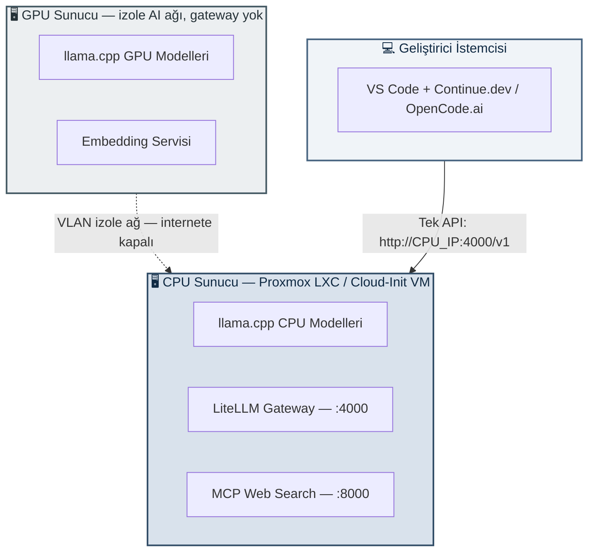

# Homelab Local AI Gateway & Orchestration

[](https://github.com/ggml-org/llama.cpp)
[](https://github.com/BerriAI/litellm)
[](https://www.proxmox.com/)
[](https://www.debian.org/)
[](https://developer.nvidia.com/cuda-toolkit)
[](https://python.org)
[](https://www.gnu.org/software/bash/)
[](https://modelcontextprotocol.io/)
[](https://continue.dev)
[](https://opencode.ai)
[](#ağ-yapısı)
[](#)
[](LICENSE)

Eski veya kısıtlı donanımları (düşük VRAM'li GPU'lar, DDR3 tabanlı CPU sunucuları vb.) tamamen **yerel, internetten izole, web arama yetenekli (MCP) ve performanslı** bir yapıda toplayıp **Yapay Zeka destekli Geliştirme Laboratuvarı** kurmak için hazırlanmış rehber, konfigürasyon ve otomasyon koleksiyonudur.

Amaç yalnızca model çalıştırmak değil; modeli, servisi, ağı ve geliştirme araçlarını birlikte yönetebilen sade, sürdürülebilir ve tamamen yerel bir AI altyapısı oluşturmaktır.

Sistem temel olarak üç bileşenden oluşur:

- **GPU sunucu** — küçük ve hızlı modeller
- **CPU sunucu** — büyük reasoning modelleri + gateway + MCP
- **Geliştirici istemcisi** — IDE ve istemci araçları

Tüm yapı tek bir **OpenAI uyumlu API** üzerinden erişilecek şekilde tasarlanmıştır.

> ⚠️ Bu repo belirli bir model veya donanıma bağımlı değildir. Amaç, düşük bütçeli veya eski sistemlerde yerel AI geliştirme altyapılarının kurulumu, optimizasyonu ve test edilmesi noktasında bir kılavuz hazırlamak; dikkat edilmesi gereken ve karşılaşılabilecek durumlara örnekler ve çözümler sunmaktır.

> 🔧 **Donanım güvenliği notu:** Zayıf/eski donanımlarda (düşük VRAM, sınırlı RAM) aynı anda birden fazla ağır modelin elle başlatılması sunucunun kilitlenmesine yol açabilir. `gpu-model-switch` ve `cpu-model-switch` araçları yeni bir modele geçmeden önce çalışan diğer servisleri otomatik durdurarak bunu engeller.

---

## Neler Sunuyor?

- **Ağ Seviyesinde İzolasyon (temel tasarım ilkesi):** AI servisleri, VLAN tabanlı, gateway'siz, internete kapalı bir ağda çalışır — güvenlik sonradan eklenen bir katman değil, mimarinin kendisidir. Detaylar için bkz. [Ağ Yapısı](#ağ-yapısı).
- **Donanım Verimliliği:** Düşük VRAM'li GPU'lar ve sınırlı kaynaklara sahip CPU sistemlerini kullanılabilir AI altyapılarına dönüştürür.
- **Hiyerarşik Çıkarım (Hierarchical Inference):** Hızlı kod tamamlama, derin analiz, embedding ve yardımcı servisleri farklı donanımlara dağıtarak kaynak kullanımını optimize eder.
- **Yerel ve Gizlilik Odaklı Çalışma:** Modeller, gateway katmanı ve yardımcı servisler tamamen yerel ağ içinde çalışır; hiçbir dış API çağrısı gerekmez.
- **Dinamik Model Yönetimi:** CPU ve GPU tarafındaki modeller `.conf` dosyaları ve model-switch araçları üzerinden yönetilir.
- **Temel Bileşen — MCP Web Search (v3):** `ai-brain.sh` ile otomatik kurulur; `@web` üzerinden güncel dokümantasyon ve web sonuçlarına erişim.
- **IDE Entegrasyonu:** Continue.dev ve OpenCode.ai üzerinden tek API ile tüm modellere erişim.
- **Tek Komutlu Kurulum (v3):** `ai-brain.sh` ile LXC veya Cloud-Init VM hedeflerinde CPU tarafı tek komutla kurulur; anahtarlar otomatik üretilir, smoke testleri çalışır.
- **Operasyonel Araçlar:** `status.sh`, `rotate-keys.sh`, `create-vm-template.sh`, `discover-pve.sh`.

Bu yapı **local-first** ve **privacy-first** çalışma yaklaşımını hedefler. Modeller iş yüküne göre ayrılır; istemci makine yalnızca merkezi servislerle iletişim kurar.

---

## Genel Mimari



Sistemin temel fikri **hiyerarşik çıkarım**dır:

- Hızlı işler GPU tarafında çözülür.
- Ağır analiz ve reasoning işlemleri CPU tarafında çözülür.
- LiteLLM bu katmanları tek API altında birleştirir.
- İstemci tarafı hangi modelin hangi cihazda çalıştığını bilmek zorunda kalmaz.

**v3'te** CPU katmanının kurulumu, ağ yapılandırması ve servis üretimi `ai-brain.sh` ile otomatikleştirilmiştir; LXC ve VM hedefleri aynı provision kodu ile kurulur.

---

## Katmanlar

### GPU Katmanı

GPU sunucu; küçük ve hızlı modeller için ayrılmıştır. Autocomplete, hızlı sohbet, kısa kod görevleri ve embedding servisleri bu katmanda çalışır. Kaynakları sınırlı GPU'larda daha küçük modeller daha verimli olduğundan yapı buna göre tasarlanmıştır. GPU model servisleri ve model-switch araçları burada bulunur.

### CPU Katmanı

CPU tarafı daha büyük bağlam ve reasoning modellerini taşır. Aynı katmanda LiteLLM Gateway, MCP Web Search, CPU model servisleri ve engine profilleri (`stock`, `prism-cpu`) bulunur. v3'te bu katmanın kurulumu `ai-brain.sh` otomasyonu ile yapılır; bütçe dostu ancak yüksek RAM kapasiteli sistemler hedeflenir.

### İstemci Katmanı

İstemci makine model çalıştırmaz. Yalnızca VS Code, Continue.dev ve OpenCode.ai gibi geliştirme araçlarını barındırır. Böylece geliştirme bilgisayarı hafif kalırken tüm AI yükü merkezi altyapıda toplanır.

---

## Ağ Yapısı

AI servisleri ayrı bir VLAN üzerinde tutulur:

- GPU sunucu yalnızca AI ağına bağlanabilir (gateway tanımlı değildir, fiziksel olarak dışarı çıkış imkânı yoktur).
- CPU sunucu hem AI ağına hem ana ağa erişebilir (çift bacak: `eth0` internete, `eth1` izole ağa bakar).
- İstemciler yalnızca gateway katmanı (LiteLLM) üzerinden servislerle konuşur.

Güvenlik bu yapıda sonradan eklenen bir katman değil, mimarinin doğrudan bir parçasıdır — ağ izolasyonu (VLAN), tek giriş noktası (LiteLLM) ve istemci tarafında model yükü olmaması bunun temel taşlarıdır.

**v3'te** bu ağ yapısı `ai-brain.sh` tarafından `pct create --net0/--net1` ve env dosyasındaki `AI_VLAN_TAG` ile otomatik oluşturulur. Elle ağ kurulumuna yalnızca otomasyon dışına çıkarsanız ihtiyaç duyarsınız.

---

## Ön Koşullar

| Bileşen | Gereksinim |
| --- | --- |
| **GPU sunucu** | NVIDIA destekli bir makine (eski Maxwell nesli dahil, bkz. Test Edilen Donanım); Arch tabanlı bir dağıtım (CachyOS vb.) önerilir; CUDA 11.7 uyumlu sürücü (ör. 470xx); `base-devel`, `cmake`, `ninja`; AUR için `paru`/`yay` |
| **CPU sunucu** | Çalışan bir **Proxmox VE** kurulumu; LXC için en az ~8 çekirdek / 32 GB RAM (28 GB'ı modele ayrılabilir); Debian 13 (template `ai-brain.sh` tarafından otomatik indirilir) |
| **Ağ** | Tek fiziksel ethernet hattı üzerinden VLAN tag'leme desteği (Proxmox `vmbr0` VLAN-aware + NetworkManager/`nmcli`) **ya da** yönetilebilir bir switch |
| **Erişim** | CPU sunucuya SSH erişimi (`ai-brain.sh` bunun üzerinden çalışır); SSH public key |
| **İstemci** | VS Code + Continue.dev eklentisi, veya OpenCode.ai (terminal/desktop) |
| **İnternet** | Yalnızca CPU sunucunun `eth0` bacağında — model indirme (`huggingface.co`) ve derleme (`github.com`) için |

Kurulumdan önce planı doğrulamak için her zaman `./ai-brain.sh --dry-run` çalıştırın.

---

## Konfigürasyon Yaklaşımı

### Model Yönetimi

Servisler tek tek elle yönetilmez. CPU ve GPU tarafı için ayrı konfigürasyon dosyaları kullanılır:

- `cpu_models.conf`
- `gpu_models.conf`

Kurulum scriptleri bu dosyalardan gerekli systemd servislerini otomatik üretir. Yeni model eklemek, parametre değiştirmek ve servis yönetmek merkezileşir. Model-switch araçları aynı mantıkla çalışır: yeni model başlatılmadan önce çalışan diğer model servisi durdurulur (RAM/VRAM kısıtı).
*Donanım kısıtı sebebiyle aynı anda tek model servisi çalışabilir durumdadır.*

### Env Tabanlı Hedef Yapılandırması (v3)

v3'te hedef yapılandırması env dosyalarına taşınmıştır:

- `.ai-brain-lxc.env` / `.ai-brain-vm.env` — Proxmox IP, CT ID, ağ, kaynaklar, DNS
- `payload/engines/*.sh` — llama.cpp fork/branch seçimi (`stock`, `prism-cpu`)
- `payload/paths.env` — yol sözleşmesi (NFR-7)
- `payload/constraints.txt` — Python sürüm sabitlemesi (NFR-3)

Kurulum öncesi `--dry-run` ile plan doğrulanır; kurulumda anahtarlar otomatik üretilir; `--update` modunda mevcut anahtarlar **korunur**.

---

## Sürüm Geçmişi

### v3

- **AI-Brain otomasyonu:** LXC ve Cloud-Init VM hedeflerinde tek komutlu kurulum
- **llama.cpp engine profilleri:** fork/branch esnekliği (`stock`, `prism-cpu`)
- **Env tabanlı yapılandırma:** `.ai-brain-*.env` + `payload/paths.env` + `payload/constraints.txt`
- **Otomatik duman testleri:** `90-smoke.sh` (MCP health, kimlik doğrulama, LiteLLM, DNS)
- **Ayrı venv'ler:** `/opt/ai_engine/venv`, `/opt/litellm/venv` — `--break-system-packages` terk edildi
- **MCP Web Search temel bileşen oldu:** `provision/50-mcp.sh` her kurulumda çalışır
- **mlock** unprivileged LXC'de otomatik çözülür (`lxc.prlimit.memlock: unlimited` + `LimitMEMLOCK=infinity`)
- **`/data` izinleri 775** (v2'de 777 idi)
- **Operasyonel araçlar:** `status.sh`, `rotate-keys.sh`, `create-vm-template.sh`, `discover-pve.sh`, `setup-proxmox-token.sh`
- **Debian 13** LXC template'i otomatik indirilir

### v2

- Uzun konfigürasyonlar ana dokümandan ayrıldı.
- CPU ve GPU servisleri modüler hale getirildi.
- `.conf` tabanlı model yönetim sistemi eklendi.
- Otomatik systemd servis üretim scriptleri eklendi.
- CPU ve GPU için model-switch araçları tanıtıldı.
- MTP destekli modeller için esnek parametre desteği eklendi.
- LiteLLM, Continue.dev ve OpenCode.ai örnek konfigürasyonları ayrı dosyalara taşındı.
- Sadece `.conf` dosyaları değiştirilip install scripti çalıştırıldığında ilgili switch scriptleri ve systemd servisleri yoksa oluşturulmakta, varsa otomatik güncellenmektedir.

### v1

- İlk sürüm; tek dokümanda manuel kurulum.

---

## Test Edilen Donanım Altyapısı

| Rol | Donanım |
| --- | --- |
| **GPU Sunucu** | Intel i7 4. Nesil + GTX 960M (4GB VRAM) + 16GB RAM |
| **CPU Sunucu** | Intel i7 4. Nesil (Haswell) + 32GB DDR3 RAM |
| **Sanallaştırma** | Proxmox VE + Debian 13 LXC (`cpu=host`, v3) |
| **İstemci** | VS Code + Continue.dev / OpenCode.ai |

> v2'de Debian 12 kullanılıyordu; v3 Debian 13 template'ini `pveam` ile otomatik indirir.

*Not: Mimari daha güçlü GPU'lara, modern CPU'lara ve farklı homelab yapılarına uyarlanabilecek şekilde tasarlanmıştır.*

---

## Test Edilen Model Aileleri

Bu repo belirli bir modele bağlı değildir. Zaman içerisinde farklı açık kaynak modeller, quantizasyon yöntemleri ve çalışma senaryoları test edilmiştir.

### Model Aileleri

| Aile | Örnek Varyant | Quant | Not |
| --- | --- | --- | --- |
| **Qwen 2.5 Coder** | Qwen2.5-Coder-3B-Instruct | Q4_K_M | GPU hızlı coder |
| **Qwen 3.5 Distill** | Qwen3.5-4B-Claude-Opus-Reasoning | Q4_K_M | GPU reasoning |
| **Qwen 3.6 A3B** | APEX-MTP, Kimi-K2.6 distill | IQ4_XS, Compact | CPU MoE, MTP |
| **Gemma 4** | gemma-4-12B-agentic-fable5 | Q8_0 | CPU, MTP, 36K ctx |
| **NVIDIA Nemotron** | Nemotron-3.5-Bolt-E4B, Nemotron-3-Nano-4B | Q8_K_XL, Q4_K_M | CPU/GPU, dflash |
| **Ternary Bonsai** | Ternary-Bonsai-2-27B | PTQ1_0 (ternary) | `prism-cpu` engine, vision (mmproj) |
| **LFM 2.5** | LFM2.5-8B-A1B-Hermes-Agentic-Coder | Q6_K | CPU, abliterated, 36K ctx |
| **OpenJev** | OpenJev | Q4_K_M | ggml-org referans |
| **Lev** | Lev | Q4_K_M | ggml-org referans |
| **DeepSeek-Coder V2 Lite** | — | GGUF | — |
| **Granite 4.x** | Granite-4.1-3B | Q4_K_M | GPU küçük |

> Bu liste sürekli büyür; yeni model eklemek için ilgili `.conf` dosyasına yeni bir blok eklemek yeterlidir.

### Model Yetenekleri

- **Speculative decoding:** `spec_type:draft-mtp` / `spec_type:draft-dflash` + `draft_dosya` alanları
- **Vision (multimodal):** `mmproj_dosya` alanı (Bonsai örneği)
- **MoE (Mixture of Experts):** Qwen 3.6 35B-A3B — DDR3 bant genişliğinde dense'e göre belirgin hızlı
- **Abliterated varyantlar:** Hermes-Agentic-Coder-Abliterated gibi
- **Uzun bağlam:** 36K context (`ctx_size:36864`) — Gemma 4 12B, LFM 2.5

### Engine Profilleri (v3)

| Profil | Repo | Kullanım |
| --- | --- | --- |
| `stock` | ggml-org/llama.cpp (mainline) | Standart GGUF quant'ları |
| `prism-cpu` | PrismML-Eng/llama.cpp (fork) | Ternary/düşük-bit GGUF (Bonsai ailesi) |

Yeni fork/branch desteği `payload/engines/` altına tek dosya eklemekle sağlanır; `cpu_models.conf` içinde `engine:<profil>` alanı ile referans verilir.

---

## Repository Yapısı

```text
.
├── README.md
├── LICENSE
│
├── v1/
│   └── homelab-ai-setups_v1.md
│
├── v2/
│   ├── configs/
│   │   ├── continue-config.yaml
│   │   ├── litellm_config.yaml
│   │   └── opencode.json
│   ├── homelab-ai-setups_v2.md
│   └── scripts/
│       ├── cpu-side/
│       │   ├── cpu_models.conf
│       │   ├── install_cpu_services.sh
│       │   └── README.md
│       ├── gpu-side/
│       │   ├── gpu_models.conf
│       │   ├── install_gpu_services.sh
│       │   └── README.md
│       └── web_search_mcp.py
│
└── v3/
    ├── homelab-ai-setups_v3.md               # Ana v3 rehberi
    ├── Quick_start.md                        # Hızlı başlangıç
    ├── hf-download-1.png                     # HF arayüzü ekran görüntüsü
    ├── hf-download-2.png
    └── aibrain/                              # AI-Brain otomasyonu
        ├── ai-brain.sh                       # Ana giriş noktası
        ├── _common.sh                        # Ortak kütüphane
        ├── ai-brain-lxc.env.example
        ├── ai-brain-vm.env.example
        ├── targets/
        │   ├── lxc.sh
        │   └── vm.sh
        ├── provision/
        │   ├── 10-base.sh
        │   ├── 20-python.sh
        │   ├── 30-engines.sh
        │   ├── 40-litellm.sh
        │   ├── 50-mcp.sh
        │   └── 90-smoke.sh
        ├── payload/
        │   ├── paths.env
        │   ├── constraints.txt
        │   ├── cpu_models.conf
        │   ├── install_cpu_services.sh
        │   ├── litellm-config.yml
        │   ├── litellm.service
        │   ├── mcp-web-search.env
        │   ├── mcp-web-search.service
        │   ├── web_search_mcp.py
        │   ├── mcp_verify.py
        │   └── engines/
        │       ├── stock.sh
        │       └── prism-cpu.sh
        └── tools/
            ├── create-vm-template.sh
            ├── discover-pve.sh
            ├── rotate-keys.sh
            ├── setup-proxmox-token.sh
            └── status.sh
```

> 🔐 Üretilen anahtar dosyası `v3/aibrain/ai-brain-<ID>-keys.txt` **git dışında** tutulur (`.gitignore` kapsamındadır).

---

## AI-Brain Araçları (v3)

`v3/aibrain/tools/` altındaki operasyonel araçlar:

| Araç | Görev |
| --- | --- |
| `status.sh` | 6 bölümlü sağlık raporu (servisler, `/health`, LiteLLM, `cpu-model-switch`, RAM/disk, DNS) |
| `rotate-keys.sh` | LiteLLM + MCP anahtar yenileme, servis restart, yerel dosya güncelleme |
| `create-vm-template.sh` | Cloud-Init VM template üretici (Debian/Ubuntu/Rocky/Alma) |
| `discover-pve.sh` | Proxmox ağ/depolama keşfi |
| `setup-proxmox-token.sh` | Proxmox API token kurulumu (opsiyonel, en az yetkili) |

---

## Başlangıç Noktası

**Yeni kurulumlar için** [`v3/homelab-ai-setups_v3.md`](v3/homelab-ai-setups_v3.md) — hızlı başlangıç için [`v3/Quick_start.md`](v3/Quick_start.md) önerilir.

v3 belgesi şunları bölümlendirilmiş şekilde ve adım adım açıklar:

- Genel mimari ve ağ izolasyonu (VLAN)
- GPU tarafı kurulum (CUDA 11.7 + glibc yaması + llama.cpp derleme)
- CPU tarafı AI-Brain otomasyonu (`ai-brain.sh`, LXC/VM hedefleri, engine profilleri)
- LiteLLM Gateway ve MCP Web Search
- Continue.dev ve OpenCode.ai entegrasyonu
- Model yönetimi, servis otomasyonu ve model-switch araçları
- Test, doğrulama ve günlük kullanım

**Eski sürümler:**

- [`v2/homelab-ai-setups_v2.md`](v2/homelab-ai-setups_v2.md) — elle kurulum, v3 öncesi
- [`v1/homelab-ai-setups_v1.md`](v1/homelab-ai-setups_v1.md) — ilk sürüm

---

## Kimler İçin?

- Eski donanımı değerlendirmek isteyen homelab kullanıcıları
- Yerel AI geliştirme ortamı kurmak isteyen geliştiriciler
- Ağ, model ve servis yönetimini tek yapıda toplamak isteyenler
- Gizlilik ve yerel çalışma önceliği olan kullanıcılar
- Sanallaştırma, ağ izolasyonu ve model orkestrasyonunu üretim öncesi laboratuvarda doğrulamak isteyenler
- **Yerel geliştirme ve gizlilik odaklı AI platformları için referans mimari arayan ekipler**

---

## Kısa Kullanım Özeti

### İlk kurulum (v3)

1. `cd v3/aibrain && cp ai-brain-lxc.env.example .ai-brain-lxc.env` + düzenleyin
2. `./ai-brain.sh --dry-run` — planı doğrulayın
3. `./ai-brain.sh --type lxc` — kurulumu başlatın (veya `--type vm`)
4. Anahtarları `v3/aibrain/ai-brain-<ID>-keys.txt` (chmod 600) dosyasından alın
5. Continue.dev / OpenCode.ai yapılandırmasına IP + anahtarı yazın
6. `./v3/aibrain/tools/status.sh --host <PVE_IP> --id <ID>` ile sağlığı doğrulayın

### Günlük kullanım

- **LiteLLM:** `http://<CPU_IP>:4000/v1`
- **MCP:** `http://<CPU_IP>:8000/sse`
- **Model değiştir:** `cpu-model-switch switch <alias>` · `gpu-model-switch switch <model>`
- **Anahtar yenile:** `./v3/aibrain/tools/rotate-keys.sh --host <PVE_IP> --id <CT_ID>`
- **Güncelleme:** `./v3/aibrain/ai-brain.sh --update --ctid <ID> --host <IP>` (anahtarlar korunur)

### Elle kurulum (v2 tarzı)

v2 belgesine bakın: [`v2/homelab-ai-setups_v2.md`](v2/homelab-ai-setups_v2.md).

---

## Bilinen Sorunlar / Sorun Giderme

| Sorun | Kısa açıklama | Çözüm / referans |
| --- | --- | --- |
| `exception specification is incompatible` derleme hatası | Güncel glibc, CUDA 11.7'nin `cospi`/`sinpi`/`rsqrt` imzalarıyla çakışır (Maxwell/eski kart + CUDA 11.7 zorunluluğunda) | `math_functions.h` içine `noexcept` yaması — v3.md **B.1.1.2** |
| `libcudart.so.11.x bulunamadı` | Sürücü/CUDA sürüm uyuşmazlığı | Symlink düzeltmesi — v3.md **B.1.4.4** |
| Unprivileged LXC'de `mlock`: `Cannot allocate memory` | `ulimit -l` varsayılanı 8 MB | v3'te otomatik çözülür (`lxc.prlimit.memlock: unlimited` + `LimitMEMLOCK=infinity`); elle kurulumda bkz. v3.md **B.2.7** |
| Sunucu kilitlenmesi / servis çökmesi | Aynı anda birden fazla ağır model elle başlatılmış | Yalnızca `gpu-model-switch` / `cpu-model-switch` ile geçiş yapın, modelleri elle paralel başlatmayın |
| LiteLLM `/v1/models` listesinde CPU modelleri görünmüyor | Wildcard model + custom `api_base` kombinasyonunda upstream keşif garantisi yok | Routing yine çalışır; istemcide model adını `cpu-brain/<gerçek-model-adı>` biçiminde yazın — v3.md **B.3.2** |
| MCP `POST /sse` → `401` | Beklenen davranış, kimlik doğrulama zorunlu | `X-API-Key`, `Authorization: Bearer` veya `?api_key=` ile istek atın — v3.md **D.3.1** |

Daha fazla hata senaryosu ve kök neden analizi için ilgili bölümün v3.md referansına bakın.

---

## Sınırlar

Bu proje bir ürün değil, **referans mimari**dir. Kurulumlar gerçek sistemlerde test edilmiştir ancak donanım ve ortam farklılıkları nedeniyle uyarlama gerekebilir. Bazı özellikler deneysel olabilir veya gelecekte değişebilir.

- MCP Web Search v3'te **temel bileşendir**; `--skip-mcp` bayrağı yoktur (Faz 4'te düşünülebilir).
- VM hedeflerinde anahtar yenileme (`rotate-keys.sh`) şu an yalnızca elle yapılır.
- Yeni hedef türü (bare-metal, farklı hypervisor) eklemek `targets/` altına 5 işlevi uygulayan yeni bir dosya yazmakla mümkündür; K8s/Docker gibi konteyner orkestrasyon hedefleri ek servis katmanı soyutlaması gerektirir.
- Ayrı veri diski bu sürümde ertelenmiştir; model ve önbellek verisi `/data` altında durur.

---

## Lisans

Bu proje [MIT Lisansı](LICENSE) altında yayınlanmaktadır.


---
