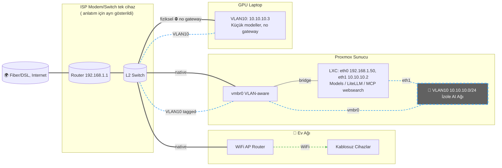
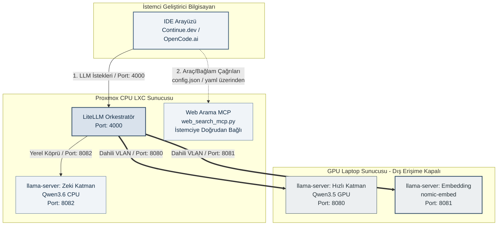

# YEREL YAPAY ZEKA GELİŞTİRME LABORATUVARI  

# 3 Cihazlı, LiteLLM Orkestrasyonlu, Tam İzole, Yamalanmış ve Optimize Sistem Kılavuzu

Bu rehber; kısıtlı donanım kaynaklarını (eski bir GPU laptop ve Proxmox tabanlı bir CPU sunucusu) en yüksek verimle birleştirmeyi amaçlayan, ağ seviyesinde tam izole, kurumsal düzeyde güvenli ve güncel,  Linux OS versiyon uyumsuzlukları giderilmiş, test edilmiş kurulum kılavuzudur. Farklı eski bilgisayarları tek bir yerel AI geliştirme altyapısında birleştirmek için hazırlanmıştır.

v1'den farklı olarak:
- Uzun konfigürasyon dosyaları ve script'ler `docs/v2/` altındaki klasörlere taşınmış, belgede sadece anlamları ve kullanımları açıklanmıştır.
- v2 mimarisi, çıkarım (inference) servislerini betiklerin içinden tamamen soyutlayarak `.conf` dosyaları üzerinden dinamik olarak yönetmeyi amaçlar.
- CPU/GPU modelleri artık **konfigürasyon dosyası (`*.conf`)** ve **tek bir kurulum script'i** ile yönetilmektedir.
- Model geçişleri için `cpu-model-switch` ve `gpu-model-switch` araçları otomatik üretilir.
- Unprivileged LXC'de `mlock` sorununa çözüm eklenmiştir.
- MTP (Multi-Token Prediction) destekli modeller için `extra_params` kullanımı açıklanmıştır.

> **📁 Klasör yapısı:** Tüm script'ler, konfigürasyon dosyaları ve IDE ayarları `docs/v2/` altında ilgili alt klasörlerde bulunmaktadır. Bu belge, içeriklerini değil, **neyin nerede olduğunu ve nasıl kullanılacağını** anlatır.

> **Donanım Güvenlik Uyarısı:** Bellek kısıtları nedeniyle, `switch` komutu hedef modeli ayağa kaldırmadan önce çalışan diğer tüm `llama-` servislerini otomatik olarak güvenli bir şekilde durdurur. Manuel olarak aynı anda birden fazla ağır model açılmaya çalışılmamalıdır; aksi takdirde sunucu kilitlenebilecektir.

Amaç:

* Tamamen yerel çalışan
* OpenAI uyumlu API sunan
* VS Code / Continue.dev / opencode.ai ile entegre
* RAG destekli( henüz uygulanmadı)
* İnternetten izole çalışabilen
* Düşük maliyetli ama profesyonel
  bir geliştirme laboratuvarı oluşturmaktır.

---

# A - GENEL MİMARİ

```text
┌────────────────────────────────────────────┐
│ GPU SUNUCU (CachyOS Laptop,i7 4. nesil)    │
│ GTX 960M 4GB VRAM + 16GB RAM               │
│--------------------------------------------│
│ llama-server (qwen3.5-4b-reasoning GPU)    │
│ llama-server (Embedding)                   │
│ 10.10.10.3                                 │
└────────────────┬───────────────────────────┘
                 │ İzole AI Ağı
                 │ 10.10.10.X
┌────────────────▼───────────────────────────────────────────────────┐
│ CPU SUNUCU(i7,4.nesil) (Proxmox LXC Debian 12)                     |
│ 32GB RAM    (LXC 28GB)                                             │
│--------------------------------------------------------------------│
│ llama-server (Qwen3.6-35B-A3B-Claude-4.7-Opus-Reasoning-Distilled) │
│ LiteLLM Proxy                                                      │
│ RAG (Planned)                                                      │
│ MCP Web Search                                                     │
│ 10.10.10.2 / 192.168.1.50                                          │
└────────────────┬───────────────────────────────────────────────────┘
                 │ LAN
┌────────────────▼────────────────────────────┐
│ GELİŞTİRME LAPTOPU                          │
│ VS Code + Continue.dev / OpenCode.ai Desktop│
│---------------------------------------------│
│ Tek API: http://CPU_SUNUCU:4000/v1          │
└─────────────────────────────────────────────┘
```

---
## A-1 MİMARİ MANTIĞI

Sistem, modelleri yeteneklerine, hızlarına ve bellek gereksinimlerine göre ayırarak **"Hiyerarşik Çıkarım (Hierarchical Inference)"** mantığıyla çalışır:

* **Hızlı Katman (GPU Laptop - CachyOS(xfce4) ):** GTX 960M (4GB VRAM) üzerinde çalışan `Qwen3.5-4B-Claude-4.6-Opus-Reasoning-Distilled-GGUF` kod tamamlama (autocomplete) modeli. Tamamen VRAM'de kaldığı için anlık tepki süresi tatmin edici seviyede denebilr. Model thinking de yapabilmektedir.
* **Zeki Katman (CPU Sunucu - Proxmox LXC Debian 12):** 32GB RAM üzerinde 28GB lık kısımda koşan `Qwen3.6-35B-A3B-Claude-4.7-Opus-Reasoning-Distilled-APEX-MTP-GGUF` karmaşık akıl yürütme (reasoning) ve derin analiz modeli.
* **Orkestrasyon ve Güvenlik Kapısı (LiteLLM Proxy):** İstemcinin hangi makineye bağlanacağını düşünmesine gerek kalmadan tek bir API arkasından modelleri ve istekleri yöneten akıllı yönlendirici.
* **İstemci Makine (Geliştirme Bilgisayarı):** Sadece VS Code ve Continue.dev eklentisini ya da Opencode.ai Terminal / Desktop çalıştırır. Üzerinde hiçbir model yükü barındırmaz.

- GTX 960M gibi eski kartlarda 7B modeller VRAM sınırına çok yaklaştığı için pratik kullanımda 3B/4B modeller daha stabil çalışır.

- `--parallel 1` kullanılması özellikle 4GB VRAM kartlarda OOM hatalarını önlemek için önemlidir.

---
## A-2  Ağ İzolasyon Stratejisi - Bu kısma ilgili kurulumlardan sonra veya esnasında bakılabilir.




Mevcut ev/ofis ağının `192.168.1.X` bloğunda internete açık olduğunu varsayalım. Güvenliği sağlamak adına internete hiç çıkışı olmayan, tamamen izole ikinci bir yapay ağ (`10.10.10.X`) oluşturulur. GPU Laptop bu ağda ana ağ geçidi (Gateway) boş bırakılarak hapsedilir. Proxmox LXC ise çift ağ bacaklı olarak yapılandırılır: Bir bacağı internete (MCP servisleri ve güncellemeler için), diğer bacağı ise sadece GPU laptop ile konuşan izole ağa bakar. Dışarıdaki modem bu bloğu tanımadığı için veri sızıntısı fiziksel olarak imkansız hale gelir.


1. **Proxmox Container (LXC - LiteLLM):** Çift ağ kartına sahip olacak . İlk kartı (`eth0`) `192.168.1.X` üzerinden internete ve MCP sunucularına bakarken , ikinci kartı (`eth1`) sadece yapay ve izole `10.10.10.X` tüneline bakacak .(**fiziksel olması gerekmiyor bridge olarak ayarlanır.**)
2. **Gizli ve İzole AI Ağı (`10.10.10.X`):** İnternet çıkışı, ağ geçidi (Gateway) ve harici fiziksel dünyayla bağı olmayan sanal bir switch (köprü) oluşturacağız .
3. **GPU Laptop (CachyOS):** Bu izole ağdan bir IP (`10.10.10.3`) alacak ve varsayılan ağ geçidi boş bırakılarak, firewall yardımıyla tamamen bu tünele hapsedilecek .

---

###  A-2.1: Proxmox Tarafı Altyapı Yapılandırması (VLAN Destekli)

Fiziksel dünyadaki tek portlu harici GPU laptopumuz ile Proxmox sunucumuzu ekstra bir ağ kablosu çekmeden, modem üzerindeki aynı hat üzerinden güvenle konuşturabilmek için ana sanal anahtarımızı (`vmbr0`) sanal odalara (VLAN) bölecek şekilde yapılandırıyoruz.

#### Adım 1: Proxmox Web Arayüzünden Ana Köprüyü "VLAN Aware" Yapma

1. Proxmox VE paneline giriş yapın.
2. Sol menüden ana sunucu ismine tıklayın, ardından **Network (Ağ)** sekmesine gelin.
3. Mevcut internete/modeme bağlı olan ana köprüyü (**`vmbr0`**) seçip üstteki **Edit** butonuna basın.
4. Açılan pencerede **VLAN Aware** seçeneğinin yanındaki kutucuğu işaretleyerek aktif hale getirin.
5. **OK** butonuna basın. Ardından üst menüde beliren **Apply Configuration** butonuna tıklayarak ağ değişikliklerini aktif hale getirin.

#### Adım 2: Proxmox LXC (LiteLLM Sunucusu) Çift Kart Ayarı (VLAN Tag ile)

Model yönetimini ve orkestrasyonunu üstlenen LXC container'ımıza, internet bacağını bozan `eth0` bacağına dokunmadan, ortak fiziksel hattan `VLAN 10` etiketiyle geçecek izole bir ikinci network kartı (`eth1`) ekleyeceğiz.

1. Proxmox sol menüsünden LiteLLM container'ınızı seçin.
2. Orta menüden **Network (Ağ)** sekmesine gelin.
3. **Add (Ekle)** butonuna basın ve parametreleri tam olarak şu şekilde doldurun:
* **Name:** `eth1` *(Mevcut internet kartınız muhtemelen `eth0` olarak kayıtlıdır)*
* **Bridge:** `vmbr0` *(VLAN Aware yaptığımız ana sanal anahtar)*
* **VLAN Tag:** `10` *(Fiziksel dünyadaki trafiği ev internetinden ayırıp izole AI tüneline sokan kritik nokta burasıdır)*
* **IPv4:** `Static` seçeneğini işaretleyin.
* **IPv4/CIDR:** `10.10.10.2/24` yazın.
* **Gateway (IPv4):** *KESİNLİKLE BOŞ BIRAKIN* *(Bu bacağın internete sızmaması ve yönlendirmesi olmaması için boş kalmalıdır)*


4. **Create** butonuna basarak kartı ekleyiniz.
5. Değişikliklerin işletim sistemi tarafından tanınması için LXC container'ı kapatıp yeniden başlatın (Reboot).

- Artık `eth0` dış dünyaya bakarken, `eth1` fiziksel ethernet kablonuzun içinden süzülen sadece `VLAN 10` etiketli `10.10.10.X` yapay zeka paketlerini dinleyecektir.
- CachyOS GPU laptop tarafında da ağ kartına `VLAN 10` kimliği ile `10.10.10.3/24` IP'si el ile (manual) tanımlanarak köprü tamamlanacaktır.

###  A-2.2: CachyOS (GPU Laptop) Tarafı Ağ İzolasyonu (VLAN Yapılandırması)
Harici GPU laptopun fiziksel port kısıtlamasını aşmak için Proxmox tarafında geçtiğimiz **VLAN Aware (VLAN Etiketleme)** altyapısına tam uyumlu olacak şekilde,  CachyOS (GPU Laptop) bölümü: 

---

Laptopumuz ağa tek bir ethernet kablosu ile bağlı olsa da, ortak hattan geçen paketleri ayırmak ve izole ağa dahil olabilmek için NetworkManager üzerinde `VLAN 10` etiketine sahip sanal bir ağ bacağı oluşturacağız. Ardından UFW ile bu bacağı tamamen dış dünyaya kapatacağız.

#### Adım 1: Fiziksel Ağ Kartının Adını Öğrenme

Terminali açın ve Proxmox sunucunuza giden fiziksel ethernet bağlantısını sağlayan kartın tam adını öğrenin:

```bash
ip link

```

*Çıktıda `enp3s0` veya `eth0` gibi bir isim göreceksiniz. Bu kılavuzda fiziksel kart adının **`enp3s0`** olduğunu varsayarak ilerleyeceğiz.*

#### Adım 2: NetworkManager (nmcli) ile İzole VLAN Bağlantısını Oluşturma

Mevcut ev interneti bağlantınızı koparmadan, `enp3s0` kartınızın arkasına sadece `VLAN 10` etiketli paketleri okuyacak ve kendine `10.10.10.3` IP'sini el ile (manual) atayacak yeni bir sanal profil ekliyoruz:

```bash
# VLAN 10 etiketli sanal bağlantı profilini oluşturun
sudo nmcli connection add type vlan con-name "AI-Izole-Baglanti" dev enp3s0 id 10 ipv4.method manual ipv4.addresses 10.10.10.3/24

# Oluşturulan yeni izole tüneli aktif hale getirin
sudo nmcli connection up "AI-Izole-Baglanti"

```
#### Adım 3: UFW Firewall ile Tam Ağ İzolasyonu (En Kritik Adım)

Laptopun internete veri sızdırmasını, dış dünyayla bağ kurmasını veya ev ağındaki diğer cihazların (Akıllı TV, telefon vb.) yapay zeka modeline erişmesini tamamen engellemek için kuralları kurumsal düzeyde katılaştırıyoruz:

```bash
# 1. Mevcut UFW kurallarını sıfırlayarak temiz bir başlangıç yapın
sudo ufw --force reset

# 2. Varsayılan politikaları kapatın (Her türlü giriş ve çıkışı tamamen engeller)
sudo ufw default deny incoming
sudo ufw default deny outgoing

# 3. Yerel döngü (Loopback - localhost) trafiğine izin verin
# (Bunu yapmazsanız laptopun kendi içindeki servisler -örneğin llama-server- kendisiyle konuşamaz!)
sudo ufw allow in on lo
sudo ufw allow out on lo

# 4. Proxmox LXC (LiteLLM) Sunucusu ile İletişim Kuralları
# Laptopun sadece Proxmox LXC (10.10.10.2) IP'sine paket göndermesine izin ver (Dışa Doğru)
sudo ufw allow out to 10.10.10.2

# Sadece Proxmox LXC (10.10.10.2) IP'sinden gelen paketleri kabul et (İçe Doğru)
sudo ufw allow in from 10.10.10.2

# 5. Güvenlik duvarını aktif edin
sudo ufw enable

```

#### Adım 4: Bağlantı ve İzolasyon Testi

Yapılandırmanın doğru çalışıp çalışmadığını doğrulamak için GPU laptopunuzda şu testleri gerçekleştirin:

1. **İzolasyon Testi (İnternet Kapalı Olmalı):** `ping 8.8.8.8` veya `ping google.com` komutunu çalıştırınız. UFW kuralları nedeniyle paketlerin kesinlikle dışarı çıkamaması ve hata vermesi gerekir.
2. **AI Tüneli Testi (Proxmox Bağlantısı Açık Olmalı):** `ping 10.10.10.2` komutunu çalıştırarak Proxmox üzerindeki LiteLLM container'ına erişebildiğinizi doğrulayın. Paketlerin kayıpsız gidip gelmesi gerekir.

---
# B - KURULUMLAR

## B.1 — GPU SUNUCU KURULUMU (Laptop 1 - CachyOS ( xfce4)  )

### B.1.1 CachyOS Ortamında Kurulum ve Temel Ayarlar

```bash
# Sistemi güncelle
sudo pacman -Syu

# Geliştirme araçları
sudo pacman -S base-devel git cmake ninja curl wget python python-pip

# NVIDIA sürücüsü (GTX 960M = Maxwell = nvidia-470xx)
sudo pacman -S nvidia-470xx-dkms nvidia-470xx-utils

# Not: CachyOS hızlı kernel güncellerse sürücü derlenemeyebilir.
#       O zaman linux-lts çekirdeğini kurup onunla başlatmak çözüm olur.
# önemli not: paru veya yay gibi bir AUR yardımcısının sistemde kurulu olması gerekir.
paru -S cuda-11.7
```
**Not:** bu aşamada çıkabilecek sorunlar için daha ileriki bölümlere bakınız.

**Doğrulama:**
```bash
nvidia-smi
```
örnek `nvidia-smi` çıktısı:

```text
❯ nvidia-smi   
Tue Jun  2 00:14:12 2026       
+-----------------------------------------------------------------------------+
| NVIDIA-SMI 470.256.02   Driver Version: 470.256.02   CUDA Version: 11.4     |
|-------------------------------+----------------------+----------------------+
| GPU  Name        Persistence-M| Bus-Id        Disp.A | Volatile Uncorr. ECC |
| Fan  Temp  Perf  Pwr:Usage/Cap|         Memory-Usage | GPU-Util  Compute M. |
|                               |                      |               MIG M. |
|===============================+======================+======================|
|   0  NVIDIA GeForce ...  Off  | 00000000:01:00.0 Off |                  N/A |
| N/A   45C    P0    N/A /  N/A |   3036MiB /  4046MiB |      0%      Default |
|                               |                      |                  N/A |
+-------------------------------+----------------------+----------------------+
                                                                               
+-----------------------------------------------------------------------------+
| Processes:                                                                  |
|  GPU   GI   CI        PID   Type   Process name                  GPU Memory |
|        ID   ID                                                   Usage      |
|=============================================================================|
|    0   N/A  N/A       851      C   ...pp/build/bin/llama-server      277MiB |
|    0   N/A  N/A       889      G   /usr/lib/Xorg                       2MiB |
|    0   N/A  N/A     85736      C   ...pp/build/bin/llama-server     2753MiB |
+-----------------------------------------------------------------------------+
```

#### B.1.1.1 CUDA Ortam Değişkenleri

#####  Çevre Değişkenlerinin Kalıcı Hale Getirilmesi

Kurulan CUDA kütüphanelerinin sistem geneline bildirilmesi için `~/.zshrc` (veya `~/.bashrc`) dosyanızın en altına şu satırları ekleyiniz:

```bash
export CUDA_HOME=/opt/cuda-11.7
export PATH=$PATH:$CUDA_HOME/bin
export LD_LIBRARY_PATH=$LD_LIBRARY_PATH:$CUDA_HOME/lib64

```
Terminali yenileyin: `source ~/.zshrc`
Kontrol:

```bash
which nvcc
```
#### B.1.1.2 Glibc / CUDA Uyumsuzluğu Düzeltmesi

Eski NVIDIA sürücüleri (örn: v470) ve eski GPU mimarileri (örn: Maxwell / GTX 960M) nedeniyle sistemde **CUDA 11.7** kullanılması zorunlu olabilir. Ancak güncel Arch Linux dağıtımlarındaki **Glibc (GNU C Library)** sürümü, `cospi`, `sinpi` ve `rsqrt` fonksiyonlarını `noexcept` (hata fırlatmayan) kuralıyla güncellenmiştir. 

CUDA 11.7'nin iç kütüphanelerinde bu kural eksik olduğu için, `llama.cpp` gibi projeleri `CMake` ile derlerken derleyici uyumsuzluk hatası (`exception specification is incompatible`) verir ve çöker.

Yedek alınız:

```bash
sudo cp \
/opt/cuda-11.7/targets/x86_64-linux/include/crt/math_functions.h \
/opt/cuda-11.7/targets/x86_64-linux/include/crt/math_functions.h.bak
```
Dosyayı düzenleyiniz: 

```bash
sudo nano /opt/cuda-11.7/targets/x86_64-linux/include/crt/math_functions.h
```

##### Değiştirilecek Satırlar ve Yeni Halleri
Editör içinde `Ctrl + W` tuş kombinasyonunu kullanarak ilgili fonksiyon adlarını aratın. Toplamda **6 farklı fonksiyon satırının** en sonundaki noktalı virgülden (`;`) hemen önce bir boşluk bırakarak `noexcept` ifadesini ekleyiniz. 

> ⚠️ **Önemli Not:** Satır başlarındaki boşlukları, `extern` makrolarını veya sondaki noktalı virgülleri kesinlikle silmeyiniz. Sadece araya `noexcept` sıkıştırınız.

###### A. cospi ve cospif Grubu
* **Eski Orijinal Satırlar:**
  ```cpp
  extern __DEVICE_FUNCTIONS_DECL__ __device_builtin__ double                 cospi(double x);
  extern __DEVICE_FUNCTIONS_DECL__ __device_builtin__ float                  cospif(float x);
  ```
* **Yeni Yamalı Satırlar:**
  ```cpp
  extern __DEVICE_FUNCTIONS_DECL__ __device_builtin__ double                 cospi(double x) noexcept;
  extern __DEVICE_FUNCTIONS_DECL__ __device_builtin__ float                  cospif(float x) noexcept;
  ```

###### B. sinpi ve sinpif Grubu
* **Eski Orijinal Satırlar:**
  ```cpp
  extern __DEVICE_FUNCTIONS_DECL__ __device_builtin__ double                 sinpi(double x);
  extern __DEVICE_FUNCTIONS_DECL__ __device_builtin__ float                  sinpif(float x);
  ```
* **Yeni Yamalı Satırlar:**
  ```cpp
  extern __DEVICE_FUNCTIONS_DECL__ __device_builtin__ double                 sinpi(double x) noexcept;
  extern __DEVICE_FUNCTIONS_DECL__ __device_builtin__ float                  sinpif(float x) noexcept;
  ```

###### C. rsqrt ve rsqrtf Grubu
* **Eski Orijinal Satırlar:**
  ```cpp
  extern __DEVICE_FUNCTIONS_DECL__ __device_builtin__ double                 rsqrt(double x);
  extern __DEVICE_FUNCTIONS_DECL__ __device_builtin__ float                  rsqrtf(float x);
  ```
* **Yeni Yamalı Satırlar:**
  ```cpp
  extern __DEVICE_FUNCTIONS_DECL__ __device_builtin__ double                 rsqrt(double x) noexcept;
  extern __DEVICE_FUNCTIONS_DECL__ __device_builtin__ float                  rsqrtf(float x) noexcept;
  ```
### B.1.2  Llama.cpp Derleme (Standart GCC ve Doğrudan CUDA Yolları) (GPU Build)

ilgili repodan llama.cpp yi indirin.

```bash
cd ~
git clone https://github.com/ggml-org/llama.cpp
cd llama.cpp
```

GLIBC `math_functions.h` yaması yapıldıktan sonra sistemdeki güncel **standart GCC derleyicisi** tamamen uyumlu hale gelmektedir. Clang derleyicisine veya paket düşürmeye (downgrade) gerek yoktur.

CMake mimarisinin `/opt/cuda-11.7` altındaki derleyici araçlarını hatasız bulması ve GTX 960M ekran kartına göre mimari avantajlarını (Maxwell - `sm_52`) tam devreye alması için derleme parametrelerini komut satırında açıkça göstererek çalıştırınız

```bash
rm -rf build

# yukarıda ortam değişkenleri kalıcı eklenmişti,fakat isterseniz
# CUDA çevre yollarını derleme oturumu için garantiye alabilirsiniz

# export CUDA_HOME=/opt/cuda-11.7
# export PATH=/opt/cuda-11.7/bin:$PATH
# export LD_LIBRARY_PATH=/opt/cuda-11.7/lib64:$LD_LIBRARY_PATH

# CUDA aktif, Maxwell mimari hedefi
# Standart GCC aktifken, CUDA yollarını komut satırından açıkça enjekte edin
cmake -B build \
  -DGGML_CUDA=ON \
  -DCMAKE_CUDA_COMPILER=/opt/cuda-11.7/bin/nvcc \
  -DCUDAToolkit_ROOT=/opt/cuda-11.7 \
  -DCMAKE_CUDA_ARCHITECTURES="50;52" \
  -DCMAKE_BUILD_TYPE=Release

#veya değişkenleri zaten görüyor ise:
cmake -B build \
  -DGGML_CUDA=ON \
  -DCMAKE_CUDA_ARCHITECTURES="50;52" \
  -DCMAKE_BUILD_TYPE=Release

# yukarıdaki kısımdan sonra 
# Derleme — $(nproc) mevcut CPU çekirdek sayısını otomatik algılar
# Tüm işlemci çekirdeklerini kullanarak derlemeyi bitirin
cmake --build build --config Release -j$(nproc)
```


### B.1.3 Model İndirme

#### B.1.3.1 Dizinler

```bash
mkdir -p ~/models/coder
mkdir -p ~/models/embedding
```
#### B.1.3.2 HuggingFace CLI

```bash
pip install huggingface-hub 

# -->  if not work / çalışmazsa
sudo pacman -S python-pipx

pipx install "huggingface_hub[cli]"
pipx ensurepath

source ~/.zshrc
```

#### B.1.3.3 GPU Kod Modeli (Hızlı coder (GPU))


```bash

# GPU kod modeli (Qwen2.5-Coder-3B)
hf download Qwen/Qwen2.5-Coder-3B-Instruct-GGUF qwen2.5-coder-3b-instruct-q4_k_m.gguf --local-dir ~/models/coder
# İsteğe bağlı diğer GPU modelleri (örnek)
hf download Jackrong/Qwen3.5-4B-Claude-4.6-Opus-Reasoning-Distilled-GGUF qwen3.5-4b-reasoning-q4_k_m.gguf --local-dir ~/models/coder
hf download ermiaazarkhalili/Granite-4.1-3B-SFT-Claude-Opus-Reasoning-Unsloth granite-4.1-3b-reasoning-q4_k_m.gguf --local-dir ~/models/coder
hf download nvidia/NVIDIA-Nemotron-3-Nano-4B-GGUF Nemotron-3-Nano-4B-Q4_K_M.gguf --local-dir ~/models/coder
```
#### B.1.3.4 Embedding Modeli ( Embedding (CPU))

```bash
hf download \
  nomic-ai/nomic-embed-text-v1.5-GGUF \
  nomic-embed-text-v1.5.Q4_K_M.gguf \
  --local-dir ~/models/embedding
```

### B.1.4 Systemd Servislerinin Yapılandırılması (GPU Laptop)

Süreçlerin arka planda kütüphane çakışması yaşamadan çalışması ve kolay yönetilebilmesi açısından için sistem servisleri hazırlanmalıdır. `Environment=` satırları kütüphane yollarını açıkça göstererek olası çökmeleri engeller.

#### B.1.4.1 Coder Servisi (GPU, Port 8080) (`/etc/systemd/system/llama-gpu-coder.service`)

##### B.1.4.1-A GPU Modelleri için Konfigürasyon (`gpu_models.conf`)

v1'de her model için ayrı systemd servisi oluşturuluyordu. v2'de tüm GPU modelleri **tek bir konfigürasyon dosyası** ile tanımlanır. Dosya yolu: `~/gpu_models.conf` (veya `/home/kullanıcı/gpu_models.conf`). Format:

```ini
model_adı:qwen2.5-coder-3b
model_dosya:qwen2.5-coder-3b-instruct-q4_k_m.gguf
port:8080
gpu_katman:33
ctx_size:8192
threads:4
hf_repo:Qwen/Qwen2.5-Coder-3B-Instruct-GGUF
extra_params:--flash-attn on
```

Her model için bir blok olacak şekilde olmalıdır, detaylara örnek dosyadan bakabilirsiniz. 
- Zorunlu alanlar: `model_adı`, `model_dosya`, `port`, `hf_repo`. 
- İsteğe bağlı: `gpu_katman` (varsayılan 33), `ctx_size` (8192), `threads` (4),
- `extra_params` modele özel parametreleri buradan girebilirsiniz (boş da bırakılabilir). 
Farklı modelleri içeren örnek bir tam konfigürasyon dosyası `docs/v2/scripts/gpu-side/gpu_models.conf` dosyasında mevcuttur.
> `gpu_katman`: GPU'ya yüklenecek katman sayısı. 33, 4GB VRAM'de Q4_K_M modellerini tamamen sığdırır.


**Önemli not:** cpu tarafından farklı olarak bu gpu tarafında, ilgili conf dosyasında tüm alternatif modeller `aynı port`tan kalkmak(8080) üzere ayarlanmıştır. gpu tarafında çok fazla model denemesi beklenmediği ve internete kapalı bir yapı kurulduğu için bu daha pratik görülmüştür. istenildiği zaman conf dosyasından port kısmı değiştirilebilir. burada amaç LiteLLM tarafında gpu tarafı için değişkliklerle uğraşmamaktır.

##### B.1.4.1-B GPU Servis Kurulum Scripti (`install_gpu_services.sh`)

v1'deki manuel servis dosyaları yerine bu script kullanılır. Script şunları yapar:
- `gpu_models.conf` dosyasını okur.
- Her model için `/etc/systemd/system/llama-gpu-<model_adı>-<sağlayıcı>.service` dosyasını oluşturur/günceller.
- `/usr/local/bin/gpu-model-switch` aracını oluşturur/günceller.

Script'i `docs/v2/scripts/gpu-side/install_gpu_services.sh` yolundan bulabilirsiniz. 

**Önemli Not:**
`ai-gpu` kullanıcısı – bu satırlar placeholder olarak verildi, gpu laptop kurulumunda ki mevcut kendi `kullanıcı adınız`la değiştiriniz" veya User=, group= satırlarını ya uyarlayınız ya da tamamen kaldırınız, bunu  `docs/v2/scripts/gpu-side/install_gpu_services.sh` dosyasından da kontrol ediniz.

```bash
chmod +x install_gpu_services.sh
sudo ./install_gpu_services.sh
```
**Detaylı anlatım için `/docs/v2/scripts/gpu-side/README.md` dosyasına bakabilirsiniz.**

##### B.1.4.1-C GPU Model Switch Aracı (`gpu-model-switch`)

Kurulumdan sonra kullanılabilir:

```bash
gpu-model-switch list          # mevcut modelleri göster
gpu-model-switch status        # hangi model aktif?
gpu-model-switch switch qwen3.5-4b   # geçiş yap
```
`path` e install* scripti ile otomatik eklendiği için **doğrudan terminalden** çağırabilirsiniz.

Script, geçişten önce çalışan tüm GPU servislerini durdurur (4GB VRAM'de aynı anda tek model çalışabilir),
bekler ve yeni modeli kaldırır.


#### B.1.4.2  Embedding Servisi (CPU, Port 8081) (`/etc/systemd/system/llama-embed.service`)

```bash
sudo tee /etc/systemd/system/llama-embed.service << 'EOF'
[Unit]
Description=Llama.cpp Embedding Service
After=network.target

[Service]
Type=simple
User=ai-gpu
Group=ai-gpu
WorkingDirectory=/home/ai-gpu/llama.cpp
Environment="LD_LIBRARY_PATH=/opt/cuda-11.7/lib64:/opt/cuda-11.7/targets/x86_64-linux/lib"
Environment="PATH=/opt/cuda-11.7/bin:/usr/local/sbin:/usr/local/bin:/usr/sbin:/usr/bin:/sbin:/bin"
ExecStart=/home/ai-gpu/llama.cpp/build/bin/llama-server \
  --model /home/ai-gpu/models/embedding/nomic-embed-text-v1.5.Q4_K_M.gguf \
  --host 10.10.10.3 --port 8081 \
  --embedding --ctx-size 2048 --threads 8
Restart=always

[Install]
WantedBy=multi-user.target
EOF

sudo systemctl enable --now llama-embed
```
#### B.1.4.3 Servisleri Başlat

GPU modelleri için kurulumdan sonra  modelin elle aktif edilmesi gerekir, switch scripti ile:

yeni scriptle asıl modelleri  çalışmaya başlatmak için: 
```bash
gpu-model-switch switch qwen2.5-coder-3b
```

embed model için ise bu şekilde:
```bash
sudo systemctl daemon-reload

sudo systemctl enable --now \  
  llama-embed.service
```

Durum kontrolü:

```bash
gpu-model-switch status 
sudo systemctl status llama-embed
```

#### B.1.4.4 `libcudart` Hatası Çözümü

Bazı CachyOS güncellemelerinde:

```text
status=127
libcudart.so bulunamadı
```

hatası oluşabilir.

Çözüm:

```bash
sudo ln -sf \
/opt/cuda-11.7/lib64/libcudart.so.11.7.99 \
/opt/cuda-11.7/lib64/libcudart.so.11.0

sudo ln -sf \
/opt/cuda-11.7/lib64/libcudart.so.11.7.99 \
/opt/cuda-11.7/lib64/libcudart.so.11.7
```

Ardından:

```bash
sudo systemctl daemon-reload
sudo systemctl restart llama-embed
```
GPU modelini yeniden başlatmak için 
```bash
gpu-model-switch switch <model> 
```
komutunu kullanınız.

---

## B.2 — CPU SUNUCU KURULUMU (Proxmox LXC - Debian 12) 

#### LXC + Debian 12 + llama.cpp CPU + LiteLLM
**LXC (Linux Container)** `cpu=host` olarak ayarlandığında  işletim sistemi çekirdeğini host ile paylaşır, sadece kullanıcı alanını izole eder. Sonuç: bare-metal'a %95 yakın performans, ama yine de güvenli izolasyon. 32GB RAM'in tamamını modele verebilirsiniz,ama iyi olanı 28GB civarı olacaktır.

Burada hem büyük kod modeli hem de LiteLLM proxy çalışacak. Ayrıca web_search_mcp server ı.

### B.2.1 LXC Oluşturma (Proxmox Web Arayüzünden) & Donanım Yapılandırması

**Önce Debian template'i indiriniz (Proxmox host shell'inde):**
```bash
# Proxmox'a SSH ile bağlan veya web arayüzünden "Shell" aç
pveam update
pveam download local debian-12-standard
```
**ya da web arayuzden templates kısmından download edebilirsiniz.**

- **CT ID:** 200  # tercihe bağlıdır,mevcut ID ler den başka istediğinizi verebilirsiniz 
- **Hostname:** ai-cpu  / ai-brain (istediğiniz bir ismi verebilirsiniz)
- **Unprivileged container:** EVET (✔) (önemli, güvenlik için)
- **Template:** debian-12-standard  | Minimal, stabil, iyi desteklenen
- **Disk:** 80 -100 GB  # minimum 60 GB ama diğer kurulumlar vs 100 GB iyi olabilir. Model çokluğuna göre `edit/resize` bölümünden artırablirsiniz, diskin SSD veya NVMe olması daha iyidir. Mevcut donanım SSD desteklemektedir.
- **CPU:** 8 çekirdek  - duruma göre 6 veya 7 `nproc` ayarlanabilir.
- **CPU Type:**  host  # `host` seçimi AVX2 optimizasyonlarını doğrudan container içine geçirir. CPU çıkarım hızı %20'ye yakın artar.

- **RAM:** 28672 MB,  #(`24576` ile `28672` MB arası)  24–28 GB uygun, makinede 32 GB RAM mevcut, 4GB Proxmox host için ayırılması saağlıklı olacaktır.
- **Swap:** 4096 MB  / 1024 de bırakılabilir. hiç bırakılmaması da duruma göre iyi olabilir.
- **Ağ:** için: 

#### Network

##### eth0 — Ana Ağ  (detaylı açıklama için ağ izolasyonu kısmına  bakınız)

| Alan    | Değer                  |
| ------- | ---------------------- |
| Bridge  | vmbr0                  |
| IP      | DHCP veya 192.168.1.50/24 |  # CIDR aralığına göre sabit vermeniz daha iyi olacaktır.
| Gateway | modem gateway          |

---

##### eth1 — İzole AI Ağı (detaylı açıklama için ağ izolasyonu kısmına  bakınız)

| Alan    | Değer         |
| ------- | ------------- |
| Bridge  | vmbr0         |	
| VLAN Tag | 10         |
| IP      | 10.10.10.2/24 |
| Gateway | BOŞ           |

---
**Başlat ve içine gir:**
```bash
pct start 200
pct enter 200
```
**ya da web arayuzden shell ile giriniz**

### B.2.2 Debian 12 İçi Hazırlık & Paketlerin kurulumu

```bash
# Paket listelerini güncelle
apt update && apt upgrade -y

# Geliştirme araçları
apt install -y \
  build-essential \
  cmake \
  git \
  curl \
  wget \
  python3 \
  python3-pip \
  python3-venv \
  htop \
  tmux \
  net-tools

# Python kütüphaneleri
# --break-system-packages: Debian 12, pip'in sistem Python'ına dokunmasını kısıtlar
# Bu flag olmadan "externally-managed-environment" hatası alırsınız
pip3 install --break-system-packages \
  huggingface-hub \
  lancedb \
  duckdb \
  fastapi \
  uvicorn \
  requests
```

### B.2.3 llama.cpp Kurulumu CPU Build (Zeki Katman) | Optimized CPU Build

Server'da GPU mevcut değil, cpu da AVX2 optimizasyonu kritik — 4. nesil i7, AVX2 ve FMA3 destekliyor ve bu talimatlar vektör hesaplamalarını (AI'nin kalbi) dramatik şekilde hızlandırıyor.

- ilgili repodan llama.cpp yi indirin.

```bash
cd /opt
git clone https://github.com/ggml-org/llama.cpp
cd llama.cpp
```
- Optimized CPU Build, derleyiniz
```bash
cmake -B build \
  -DGGML_AVX2=ON \
  -DGGML_F16C=ON \
  -DGGML_FMA=ON \
  -DGGML_CUDA=OFF \
  -DCMAKE_BUILD_TYPE=Release \
  -DCMAKE_C_FLAGS="-march=native" \
  -DCMAKE_CXX_FLAGS="-march=native"

cmake --build build --config Release -j$(nproc)
```

| Flag | Gerekçe |
|---|---|
| DGGML_AVX2=ON | 256-bit SIMD vektör hesaplama sağlar. |
| DGGML_F16C=ON | FP16↔FP32 donanım dönüşümünü aktif eder. |
| DGGML_FMA=ON | Fused Multiply-Add: Çarpma ve toplama işlemini tek clock döngüsünde yapar. Haswell FMA3 desteklidir, tensör hesaplamalarında %5–10 ek hız sağlar. |
| DCMAKE_C_FLAGS="-march=native" | Derleyiciyi mevcut donanım için optimize eder. Haswell mimarisine özgü tüm pipeline ve cache optimizasyonlarını aktif hale getirir. Derlenen paket başka bir makinede çalışmaz ancak bu homelab için idealdir. |
| DCMAKE_CXX_FLAGS="-march=native" |	Derleyicinin işlemciye özgü tüm optimizasyonları (AVX2, FMA, BMI, POPCNT vb.) kullanmasını sağlar. Binary başka makinelerde çalışmaz, ancak homelab için maksimum performansı verir. |


**Sistem (Haswell mobil platform  4. nesil i7, 32 gb ram, 512 ssd + proxmox) geneli için performans kontolleri:**
| Nerede | Bileşen                | Durum                | Not                               |
| ---- | ---------------------- | -------------------- | --------------------------------- |
| host | CPU Governor           | ✅ Optimize           | performance aktif                 |
| host | CPU Passthrough        | ✅ Optimize           | cpu=host                          |
| lxc | llama.cpp Derleme      | ✅ Optimize           | AVX2 + FMA + F16C + march=native  |
| host | Transparent Huge Pages | ✅ Optimize           | madvise                           |
| lxc conf | Memlock                | ✅ Optimize           | unlimited +(systemd service) LimitMEMLOCK=infinity |
| host | TRIM                   | ✅ Optimize           | fstrim.timer aktif                |
| host | I/O Scheduler          | ✅ Optimize           | mq-deadline                       |
| lxc | Swap Kullanımı         | ✅ Optimize           | 0 byte kullanım                   |
| host | NUMA                   | ✅ Sorun yok          | Tek NUMA node                     |
| host | ZFS ARC Çakışması      | ✅ Yok                | ZFS kullanmıyoruz                |
| host | SSD Sağlığı / Yapı     | ✅ İyi                | LVM-thin sağlıklı                 |
| host | Thin Metadata          | ✅ İyi                | %2.23                             |
| host | CPU Sıcaklığı          | ✅ Çok iyi            | ~48°C boşta                       |
| host | HugePages Havuzu       | 🟡 Test edildi       | 2 GB ayırıldı  ( vm.nr_hugepages=1024)                    |


### B.2.4 Model İndirme (Qwen3-Coder-30B-A3B-Instruct-GGUF)

```bash
mkdir -p /data/models
```
-  Dense mimaride her token üretiminde modelin tüm ağırlıkları bellekten geçer. DDR3 1600 MHz çift kanal teorik bant genişliği ~25.6 GB/sn, efektif ise ~18–20 GB/sn düzeyindedir.

- Ham işlemci hızı değil, bellek veri yolu genişliği bu kısıta neden olur. Dense modelden MoE'ye geçmek dışında DDR3 üzerinde bu tavanı aşmanın yolu pek görünmemekte olup yine de farklı modeller denenebilir.

- `MoE (Mixture of Experts)` mimarisinde model aynı RAM alanını tutsa da her token üretiminde yalnızca aktif uzman katmanları bellekten geçer


#### Modeller
```bash
# Qwen3-Coder-30B-A3B Q3_K_M
hf download unsloth/Qwen3-Coder-30B-A3B-Instruct-GGUF Qwen3-Coder-30B-A3B-Instruct-Q3_K_M.gguf --local-dir /data/models

# DeepSeek-Coder-V2-Lite
hf download lmstudio-community/DeepSeek-Coder-V2-Lite-Instruct-GGUF DeepSeek-Coder-V2-Lite-Instruct-Q4_K_M.gguf --local-dir /data/models

# Gemma4-26B-A4B (unsloth)
hf download unsloth/gemma-4-26B-A4B-it-GGUF gemma-4-26B-A4B-it-UD-Q4_K_XL.gguf --local-dir /data/models

# Qwen3.6 MTP ve diğer modelleri 
hf download mudler/Qwen3.6-35B-A3B-Claude-4.7-Opus-Reasoning-Distilled-APEX-MTP-GGUF Qwen3.6-35B-A3B-Claude-4.7-Opus-Reasoning-Distilled-APEX-MTP-I-Compact.gguf --local-dir /data/models

hf download mudler/Qwopus3.6-35B-A3B-v1-APEX-MTP-GGUF Qwopus3.6-35B-A3B-v1-APEX-MTP-I-Compact.gguf --local-dir /data/models

hf download Dyluhn/lordx64-Qwen3.6-35B-A3B-Claude-4.7-Opus-Reasoning-Distilled-MTP-GGUF lordx64-distill-MTP-IQ4_XS.gguf --local-dir /data/models

hf download lordx64/Qwen3.6-35B-A3B-Kimi-K2.6-Reasoning-Distilled-GGUF Qwen3.6-35B-A3B-Kimi-K2.6-Reasoning-Distilled.IQ4_XS.gguf --local-dir /data/models
```
### B.2.5 CPU Model (Derin Analiz) İşlemleri ve  Özel script

gerekli llama-server parametre tablosu aşağıdadır:
#### B.2.5.1 llama-server Parametre Tablosu


| Parametre | Değer | Gerekçe |
|---|---|---|
| -m |model fiziksel dosya adı |  |
| -t / -tb | 4 / 4 | Fiziksel çekirdek sayısına sabitle — HT rekabeti ve L1/L2/L3 kirlenmeyi önler. |
| -c | 16384 | Kod tabanı analizi için yeterli bağlam penceresi. |
| --mlock | (aktif) | Ağırlıkları RAM'e kilitle, Proxmox swap mekanizmasını devre dışı bırak. |
| -ctk / -ctv | q8_0 / q4_0 | Haswell ALU'ya Q*_0 dekompresyon yükü bindirme,  net kazanç sağlar. |
| --parallel | 1 | Tek kullanıcılı ortamda CPU scheduler ve thread yönetim yükünü minimize et. |
| -fa | on | Flash Attention — bellek erişim örüntüsünü optimize eder. |
| --host | 127.0.0.1 | LiteLLM aynı container içinde; dışarı açmaya gerek yok. |
| --port | 8081 | Mevcut kurulumla çakışmayı önle (8080 varsa). |

---

#### B.2.5.2 CPU Modelleri için Konfigürasyon (`/data/cpu_models.conf`)

v1'deki gibi elle servis dosyası oluşturmak yerine, tüm CPU modellerini bu dosyada tanımlayın. Format:

```ini
alias:qwen3-30b
model_adı:qwen3-coder-30b
model_dosya:Qwen3-Coder-30B-A3B-Instruct-Q3_K_M.gguf
port:8081
ctx_size:16384
threads:4
threads_batch:4
hf_repo:unsloth/Qwen3-Coder-30B-A3B-Instruct-GGUF
extra_params:--cache-type-k q8_0 --cache-type-v q4_0 --flash-attn on
```
install scriptin ilgili kısmı: 
```bash
ExecStart=$LLAMA_BUILD/bin/llama-server \
  --model $full_model_path \
  --host $host \
  --port $port \
  --ctx-size $ctx_size \
  --threads $threads \
  --threads-batch $threads_batch \
  --parallel 1 \
  --batch-size 2048 \
  --ubatch-size 256 \
  --timeout 600 \
  --mlock \
  $extra_params
```
`alias` switch komutunda kullanılır.
`extra_params` ile hem modele özgü parametreler hem de MTP modellerine özel parametreler eklenebilir (örneğin `--spec-type draft-mtp --spec-draft-n-max 3`). bu esneklik sağlammıştır.
Farklı modelleri de içeren Tam bir örnek konfigürasyon `docs/v2/scripts/cpu-side/cpu_models.conf` dosyasında mevcuttur.

#### B.2.5.3 CPU Servis Kurulum Scripti (`install_cpu_services.sh`)
- v1'deki `install_services.sh`'in yerini alır, daha esnektir.
Script şunları yapar:
- `/data/cpu_models.conf` dosyasını okur.
- aynı v1 de olduğu gibi her model için `/etc/systemd/system/llama-cpu-<model_adı>-<sağlayıcı>.service` dosyasını oluşturur/günceller.

- `/usr/local/bin/cpu-model-switch` aracını otomatik oluşturur/ günceller. 
- her çalıştırmada bunu yapar.

Script'i `docs/v2/scripts/cpu-side/install_cpu_services.sh` yolunda bulabilirsiniz. 

Kullanım:

```bash
chmod +x install_cpu_services.sh
./install_cpu_services.sh   # LXC içinde root, sudo gerekmez
```
- Model dosyalarının varlığı kontrol edilir, eksikse uyarı verir ama `indirme yapmaz` (manuel indirmeniz gerekiyor)
- Argüman gerekmez – sadece  ./install_cpu_services.sh çalıştırılır.
- Tek bir betik hem `servis`leri hem de `cpu-model-switch` aracını yoksa **oluşturur** varsa **günceller**.
- Konfigürasyon (*.conf dosyası) değişince  aynı komutu çalıştırarak tüm service leri ve scripti güncelleyebilirsiniz.


#### B.2.5.4 CPU Model Switch Aracı (`cpu-model-switch`)

Kurulumdan sonra:
`path` e `install*` scripti ile otomatik eklendiği için **doğrudan terminalden** çağırabilirsiniz.

```bash
cpu-model-switch list
cpu-model-switch status
cpu-model-switch switch qwen3-30b   # geçiş
```
- Aynı anda sadece bir CPU modeli çalışabilir (28GB RAM kısıtı). 
- **Switch komutu önceki servisi durdurur, bekler ve yenisini başlatır.**
- Model geçişleri sadece **`cpu-model-switch`** ile yapılır, **ekstra servis yönetimi**ne gerek yoktur.
- `service_base` otomatik olarak `model_adı-sağlayıcı` şeklinde (sağlayıcı `hf_repo`'dan alınır).
**detaylı anlatım için `/docs/v2/scripts/cpu-side/README.md` dosyasına bakabilirsiniz.**


#### B.2.6 Unprivileged LXC'de `mlock` Sorunu ve Çözümü (v2'ye özgü)

**Sorun:** Unprivileged LXC'de root bile varsayılan olarak belleği kilitleyemez (`mlock`). `llama-server --mlock` kullanıldığında `failed to mlock: Cannot allocate memory` hatası alınır.

LXC konteynerinin içi incelendiğinde `ulimit -l` (kilitlenebilir bellek sınırı) değerinin sadece **8192 KB (8 MB)** olduğu görülmüştür.

**Çözüm:** Çift Katmanlı Tavan Kaldırma

Kilitli bellek limitini hem dışarıdan (Host) hem de içeriden (Guest/Systemd) senkronize bir şekilde kaldırmak gerekir:

1. **Dış Kapı (Proxmox Host Katmanı):** Ana sunucuda `/etc/pve/lxc/[Konteyner_ID].conf` dosyası açıldı ve  konteynıra ana sunucu seviyesinde sınırsız yetki tanındı:

**Proxmox host'ta**
```bash
nano /etc/pve/lxc/200.conf
```
en altına şu satır eklenmeli:
```ini
lxc.prlimit.memlock: unlimited
```
Ardından container'ı yeniden başlatın:

```bash
pct stop 200 ; pct start 200
```

2. **İç Kapı (Konteyner/Systemd Katmanı):** `install_cpu_services.sh` betiğine üreteceği her bir systemd servis dosyasına şu parametre gömülerek çekirdek izni uygulamaya geçirildi:
```ini
LimitMEMLOCK=infinity

```

Bu sayede `--mlock` belleği kilitleyebilir ve swap kullanımını önler.

#### B.2.7 İşlemci Çekirdeği ve Bellek Bant Genişliği (Threads & ubatch) Optimizasyonu

**Mevcut Durum**

İşlemci fiziksel olarak **4 Çekirdek / 8 Thread** mimarisine sahiptir ve **6 MB L3 Önbelleğe (Cache)** sahiptir. Sistem belleği **DDR3** mimarisidir. Proxmox tarafında bu konteynere mantıksal olarak 7 çekirdek atanmıştır (`nproc` = 7).(bu durum sizde değişebilir, ana konu fiziksel duruma uyumluluk sağlanmasıdır.)

**Sorun:**

CPU üzerinde LLM çalıştırırken en büyük darboğaz işlem gücü değil, verinin yavaş olan DDR3 RAM'den CPU çekirdeklerine taşınmasıdır (Bellek bant genişliği). Eğer thread sayısı `nproc` değerine bakılarak 7 yapılsaydı, Hyper-Threading devreye girecek ve mantıksal çekirdekler aynı fiziksel çekirdeğin L2/L3 önbelleğini kapışarak hızı dramatik şekilde düşürecekti.
Ayrıca varsayılan mikro-paket boyutu (`ubatch`) büyük olduğunda, işlemci ara matris hesaplamalarını 6 MB'lık L3 önbelleğine sığdıramayıp sürekli RAM'e yazıp okuyacaktı (Cache Miss).

**Çözüm:**

1. **Thread Sabitleme:** `--threads 4` ve `--threads-batch 4` ayarı korunarak tam olarak fiziksel çekirdek sayısı kadar thread atanmıştır. Bu sayede her thread kendine ait bir fiziksel çekirdeği ve önbelleği verimli şekilde kullanır.
2. **Micro-Batching (ubatch) Ayarı:** Büyük promptlar geldiğinde işlemcinin boğulmaması için prompt parçalama boyutu optimize edilmiştir. `install_cpu_services.sh` betiğinde komut setine `--batch-size 2048 --ubatch-size 256` eklenerek ara hesaplamaların RAM yerine tamamen hızlı işlemci önbelleğinde (L3/L2) dönmesi sağlanmıştır.


## B.3 — LiteLLM API Gateway (Aynı CPU LXC’de)

CPU sunucusu (LXC) üzerinde çalışacak.
### B.3.1 LiteLLM Kurulumu

LiteLLM, iki modeli (GPU & CPU) tek bir OpenAI uyumlu uçta birleştirecek.

**LiteLLM nedir tam olarak?**

OpenAI API formatında istekler alıp, farklı backend'lere (llama.cpp, Ollama, gerçek OpenAI, Anthropic vb.) yönlendiren bir proxy. 
Bu yapımızda üçüncü  bir cihaz buraya tek bağlantı yapacak: Continue.dev / Opencode.ai tek bir adres biliyor olacak (`http://SERVER_IP:4000/v1`), model seçimine göre LiteLLM doğru makineye / modele  yönlendiriyor.


```bash
pip3 install --break-system-packages 'litellm[proxy]'
```

### B.3.2 LiteLLM Konfigürasyon (`/opt/litellm/config.yaml`)

konfigürasyon dosyası (`litellm_config.yaml`) artık `docs/v2/configs/` klasöründedir. İçeriği v1'deki gelişmiş yaml ile hemen hemen aynıdır, sadece daha fazla CPU modeli (8081-8089 arası portlar) ve GPU modelleri tanımlanmıştır.

dosya yolunu oluşturunuz: 

```bash
mkdir -p /opt/litellm
```
dosyayı da oluşturunuz:

```bash
nano /opt/litellm/config.yaml
```
verilen dosya içeriğini dosyaya kopyalayıp yapıştırınız.

**gelişmiş litellm yaml config:**

 Önemli değişkenler:

- `model_name`: IDE'de görünen ad (örneğin `hizli-gpu`, `derin-cpu-deepseek`)
- `api_base`: İlgili servisin adresi (GPU için `http://10.10.10.3:8080/v1`, CPU için `http://127.0.0.1:8081/v1` vb.gibi)
- `master_key`: LiteLLM proxy'sine erişim için kullanılır (rastgele bir string).

mevcut enabled edilmiş tüm service leri öğrenmek için:
```bash
systemctl list-unit-files --type=service --state=enabled
```

**`master_key`** neden var? LiteLLM'e gelen her istekte bu key olmalı, yoksa reddeder. Bu gerçek bir güvenlik önlemi değil — yerel ağda başka bir cihazın yanlışlıkla (veya kasıtlı olarak)  modellerinizi kullanmasını önler. İstediğiniz herhangi bir kelimeyi yazabilirsiniz. 

kalıp :
```bash
curl http://localhost:4000/v1/models -H "Authorization: Bearer `master_key`"

```
örnek: 
```bash
curl http://localhost:4000/v1/models -H "Authorization: Bearer yerel-ai-sifrem"
```


### B.3.3 LiteLLM Servisi 
#### (`/etc/systemd/system/litellm.service`)

```bash
tee /etc/systemd/system/litellm.service << 'EOF'
[Unit]
Description=LiteLLM Proxy
After=network.target

[Service]
Type=simple
ExecStart=litellm --config /opt/litellm/config.yaml --port 4000
Restart=always

[Install]
WantedBy=multi-user.target
EOF
```
####   Servisi Başlat

```bash
sudo systemctl daemon-reload

systemctl enable --now litellm
```

Durum kontrolü:

```bash
sudo systemctl status litellm

```

---

# C — İSTEMCİ LAPTOP (Geliştirme Makinesi)

Artık kod yazdığınız makine. Hiçbir model yükü yok.

## C.1 VS Code + Continue.dev Kurulumu

VS Code → Extensions → “Continue.dev” aratıp yükleyiniz.

## C.2 Continue Konfigürasyonu

`~/.continue/config.yaml` dosyasını şu şekilde düzenleyiniz:

v1'deki uzun yaml bloğu artık `docs/v2/configs/continue-config.yaml` dosyasına taşınmıştır. 
Bu dosyada:
- Tüm GPU ve CPU modelleri (`hizli-gpu`, `derin-cpu`, `derin-cpu-deepseek`, `gemma4-cla-ops`, MTP modelleri vb.) tanımlanmıştır.
- `apiBase` adresi LiteLLM sunucusunun IP'si ve port 4000 olarak ayarlanmıştır.
- `Authorization` header'ında `master_key` kullanılır.
- Özel slash komutlar (`/complexity`, `/profile`, `/review` vb.) mevcuttur.
- MCP web search sunucusu `mcpServers` bölümünde tanımlanmıştır.

Kullanıcı,  `docs/v2/configs/continue-config.yaml` dosyası içeriği kopyalayıp `~/.continue/config.yaml` konumuna ekleyerek içindeki IP adreslerini ve anahtarları kendi ağına göre düzenlemelidir.

Bu ayarlarla artık Continue.dev sohbet ekranında  modeller arasında geçiş yapabilirsiniz.
- (tavsiye) mcp server için vscode'da ayarlarda, ilgili kısımda `ask` yerine `otomatik` olarak ayarlayabilirsiniz.


## C.3. OpenCode.ai (Terminal / Desktop) Konfigürasyonu (İsteğe Bağlı)

buradan [`https://opencode.ai/download`](https://opencode.ai/download) indirebilirsiniz, ayrıca vscode eklentisi de mevcuttur.

opencode.ai için de config lerin uyarlanmış hali şu şekildedir: 

`docs/v2/configs/opencode.json` dosyası içeriği kopyalanıp `~/.opencode/opencode.json` konumuna eklenerek düzenlenebilir. İçinde provider, modeller, subagent'lar ve MCP ayarları bulunur.
- detaylandırılmıştır ve seviye ayarlamaları sembolik olarak yapılmıştır, precise,balanced,creative gibi.
bu kısım meşhur Model sağlayıcıların `high`, `Max` gibi ayarlarının yapıldığı kısma denk gelir.
```json
"variants": {
            "precise": {
              "options": { "temperature": 0.0, "topP": 0.9 }
            },
            "balanced": {
              "options": { "temperature": 0.8, "topP": 0.92 }
            },
            "creative": {
              "options": { "temperature": 1.0, "topP": 0.98, "topK": 100 }
            }
```

- MCP web search için de gerekli ayarlar eklenmiştir:

keyleri `~/.bashrc` veya `~/.zshrc` dosyasında tanımlayabilirsiniz, `ENV` olarak görecektir.

örnek `~/.zshrc` kısmı, en alta ekleyiniz:

```ini
export PATH=/home/username/.opencode/bin:$PATH
export LITELLM_API_KEY="yourlitellm key"
export MCP_API_KEY="your MCP api key"
```
config de MCP lerle ilgli kısım: 
```json

"mcp": {
    "web-search-homelab": {
      "type": "remote",
      "url": "http://192.168.1.50:8000/sse",
      "headers": {
        "X-API-Key": "{env:MCP_API_KEY}"
      },
      "enabled": true
    }
  },
```
örnek opencode.ai örnek dizin yapısı:

```tree
~/.opencode/
├─ opencode.json
├─ AGENTS.md
├─ instructions/
│  └─ mcp-guidance.md
└─ commands/
   ├── api.md
   ├── async.md
   ├── complexity.md
   ├── docstring.md
   ├── get-last-session.md
   ├── numpy.md
   ├── profile.md
   ├── pytest.md
   ├── refactor.md
   ├── review.md
   ├── session-save.md
   └── typecheck.md

```

---

# D — WEB ARAMA ENTEGRASYONU- MCP Web Search Sunucusu(Opsiyonel) - Uygulandı.

CPU sunucusuna basit bir MCP web arama sunucusu ekleyerek güncel bilgi çekebiliriz. 
- v2 sürümümüzde Python kodu  (`web_search_mcp.py`) artık bu dosyada değil, ilgili `docs/v2/scripts/` klasöründe saklanmaktadır.
- Aynı şekilde `/opt/ai_engine/` altına kopyalanır, systemd servisi ile başlatılır. 

Önemli değişkenler:

- `MCP_SECRET_KEY`: MCP sunucusuna erişim için API anahtarı (IDE konfigürasyonunda kullanılır).
- `MAX_RESULTS`, `CACHE_TTL_SECONDS` gibi parametreler ayarlanabilir.

## D.1 Kurulum

- Homelab felsefesine en uygun, herhangi bir ücretli API anahtarı (Google, Tavily vs.) gerektirmeyen ve tamamen sınırsız kullanabileceğiniz en temiz yöntem `DuckDuckGo` kütüphanesini kullanmaktır

 LXC container da ilgili paketleri kurunuz : 
```bash
pip3 install --break-system-packages \
      mcp \
      fastapi \
      uvicorn \
      uvloop \
      ddgs \
      cachetools \
      beautifulsoup4 \
      requests 
```
**Not:** `duckduckgo-search` paketi deprecated olduğu için onun yerine `ddgs` paketi kurulmalıdır**

## D.2 MCP Sunucusu (`/opt/ai_engine/web_search_mcp.py`)

### D.2.1 Yapı Görseli

Yerel AI Laboratuvarı ve MCP İletişim Diyagramı (Mermaid)



### D.2.2 Kod kısmı

**Dikkat:** Kodun içerisinde Homelab sistemi için kritik öneme sahip şu özel yapılar vardır:

- `uvloop` ile asenkron olay döngüsü optimizasyonu.(CPU kısıtlarına rağmen çok düşük bir memory (51.4M)ve CPU kullanımı ile yüksek ağ performansı elde ediyorsunuz.)

- `ThreadPoolExecutor(max_workers=2)` ile arama motoru isteklerinin işlemciyi yormayacak şekilde iş parçacıklarına bölünmesi.

- `TTLCache` ile özel önbellekleme (Cache hit / Cache store) mantığı.

- `Gelişmiş regex temizlikleri`, domain ağırlıklandırma algoritmaları ve adaptif özet boyutlandırma (compact_result).

- `@mcp_server.list_tools()` ve `@mcp_server.call_tool()` şeklinde ham dekoratörler.

bunlardan dolayı `FastMCP` değil `Ham Server` + `SseServerTransport` şeklinde entegre edilmişitr.
**servisin sorunsuz ve çok düşük kaynak tüketimiyle** ayağa kalkmasını sağlayan şey de bu tercih oldu.

klasör oluşturun: 
```bash
mkdir -p /opt/ai_engine
```
dosyayı oluşturun: 
```bash
nano /opt/ai_engine/web_search_mcp.py

```
`docs/v2/scripts/web_search_mcp.py`  dosyasından içeriği ekleyiniz.

çalıştırılabilir hale getiriniz:
```bash
chmod +x  /opt/ai_engine/web_search_mcp.py
```

## D.3 7/24 Çalışacak MCP Sunucusu Systemd Servisi Oluşturma

Servisin sunucu açıldığında otomatik başlaması ve çökme durumunda kendini canlandırması için bir daemon tanımlayın:

```bash
nano /etc/systemd/system/mcp-web-search.service

```

İçerisine şu konfigürasyonu girin:

```ini
[Unit]
Description=Homelab MCP Web Search Service (SSE)
After=network.target

[Service]
Type=simple
User=root
WorkingDirectory=/opt/ai_engine
ExecStart=/usr/bin/python3 /opt/ai_engine/web_search_mcp.py
Restart=always
RestartSec=5

[Install]
WantedBy=multi-user.target

```

Servisi kaydedip çıkın, ardından aktif hale getirin:

```bash
systemctl daemon-reload
systemctl enable --now mcp-web-search.service

```
**kontroller:**
```bash
systemctl status mcp-web-search.service

journalctl -fu mcp-web-search.service 
```
 lxc içinden Test: `curl http://localhost:8000/health` → `{"status":"ok"}`

---

# E — KOD TABANI ARAMA (LanceDB + DuckDB, Opsiyonel) -( UYGULANMADI)

**Önemli:** Continue.dev’in kendi `@codebase` özelliği de arama yapabilir. Eğer onu kullanmak isterseniz LanceDB’ye gerek kalmaz.  
Ama tam kontrol ve özel chunking istiyorsanız, kurulması iyi olacaktır. Bu durumda,  sistemi kurun ve Continue’un dahili indekslemesini kapatın (`"disableIndexing": true` ekleyiniz).

**Not:** Bu kısım  uygulanmadığı için bu dökümanda yer verilmemiştir.

# F — TEST VE DOĞRULAMA


1. **GPU servisi:** `curl http://10.10.10.3:8080/v1/models` → model listesi dönmeli.
2. **Embedding servisi:** `curl -H "Content-Type: application/json" -d '{"content":"test"}' http://10.10.10.3:8081/embedding`
3. **CPU servisi (aktif modele göre):** `curl http://127.0.0.1:8081/v1/models` (veya ilgili port)
4. **LiteLLM:** `curl http://192.168.1.50:4000/v1/models -H "Authorization: Bearer key"`
5. **Continue.dev:** VS Code'da Ctrl+L ile sohbet açıp "merhaba" yazın, yanıt gelmeli.

genel, ip bağımsız: 
1. **GPU servisi:**  
   `curl http://GPU_IP:8080/v1/models` → model listesi dönmeli.

2. **Embedding servisi:**  
   `curl -H "Content-Type: application/json" -d '{"content":"test"}' http://GPU_IP:8081/embedding` → embedding vektörü dönmeli.

3. **CPU model servisi:**  
   `curl http://CPU_IP:8080/v1/models` →  model listelenmeli.

4. **LiteLLM:**  
   `curl http://CPU_IP:4000/v1/models` → `hizli-gpu` ve `derin-cpu` modelleri görünmeli.

5. **Continue.dev bağlantısı:**  
   VS Code’da Ctrl+L ile Continue panelini açın, model seçiminden “Hızlı GPU” seçip basit bir soru sorun. Cevap gelmeli.

---

# G — API ANAHTARI MESELESİ 

**Soru:** Bu sistem tamamen yerel, neden `apiKey` diye bir şey var? Ücretli bir anahtar mı gerekli?  
**Cevap:** Hayır, hiçbir dış servise bağlanmıyoruz.  
- llama.cpp’nin dahili OpenAI uyumlu sunucusu, gelen isteklerde `Authorization: Bearer <token>` başlığını görür ama **hiçbir doğrulama yapmaz**. Yani ne yazarsanız yazın kabul eder.  
- Ancak kullandığımız istemci kütüphaneleri (Continue.dev gibi) **boş bir `apiKey` göndermeye izin vermez**, bir şeyler yazılmasını zorunlu kılar.  
- Biz de bu zorunluluğu aşmak için **"dummy"** veya istediğimiz herhangi bir kelimeyi yazıyoruz.  
- LiteLLM’deki `master_key` ise **LiteLLM proxy’sine erişim için kendi belirlediğimiz bir şifredir**. İstemci makine bu şifreyi bilmezse proxy’yi kullanamaz. Bu da yerel ağdaki basit bir güvenlik önlemidir, ücretli bir API anahtarı değildir.

Özetle: Hiçbir yerde kredi kartı, OpenAI kaydı, ücretli hesap gerekmez. Tüm sistem ücretsiz ve yerel ağınıza özeldir.

---

# H — GÜNLÜK KULLANIM ÖZETİ

1. İki sunucu makineyi açık bırakın.
2. Geliştirme laptopunuzda VS Code’u açın.
3. Continue sohbet penceresinde ihtiyaca göre:
   - `@codebase` ile proje genelinde arama yapın (LanceDB kurduysanız),
   - `@web` ile güncel konuları araştırın,
   - Küçük değişiklikler için **Hızlı GPU** modelini, büyük mimari işler için **Derin CPU** modelini seçin.
4. eğer RAG de kurdu iseniz, haftada bir `python3 /opt/ai_engine/indexer.py` çalıştırarak yeni kodları indekse ekleyiniz.


- **GPU model değiştirmek:** `gpu-model-switch switch qwen3.5-4b` // bunlar `şu an için` sadece ilgili cihazdan yapılabilir
- **CPU model değiştirmek:** `cpu-model-switch switch qwen3-30b`  // bunlar `şu an için` sadece ilgili cihazdan yapılabilir
- **Durum sorgulamak:** `gpu-model-switch status` / `cpu-model-switch status` // bunlar `şu an için` sadece ilgili cihazdan yapılabilir
- **LiteLLM ve MCP servislerinin çalıştığından emin olun:** `systemctl status litellm mcp-web-search` // LXC içinden veya ssh ile istemci laptoptan
---

# TEKNİK ÖZET TABLOSU

| Bileşen | Hangi Makine | Görev |
|--------|--------------|-------|
| llama-server (GPU) | GPU Laptop | Hızlı kod yazımı, autocomplete |
| llama-server (CPU) | CPU LXC | Derin analiz, büyük bağlam |
| LiteLLM | CPU LXC | Tek uç nokta, model yönlendirme |
| lanceDB + DuckDB | uygulanmadı | Kod vektör veritabanı, metadata |
| nomic-embed | GPU Laptop | Kod parçalarını vektöre çevirme |
| Continue.dev | İstemci Laptop | IDE içi AI asistan arayüzü |
| Opencode.ai Desktop / Terminal | İstemci Laptop | IDE / AI asistan arayüzü |
| Web arama MCP | CPU LXC | Güncel web sonuçlarını getirir |

---

## Sonuç

Bu rehber ile üç cihazınızı (GPU laptop, Proxmox CPU sunucu, geliştirme istemcisi) tam verimle kullanan, tamamen yerel, ücretsiz, internetten izole ve yüksek performanslı bir yapay zeka geliştirme laboratuvarına sahip olacaksınız. Script tabanlı yaklaşım sayesinde yeni modeller eklemek ve konfigürasyonu güncellemek çok kolaydır.  


