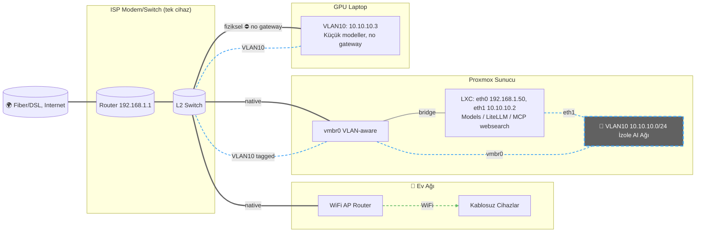
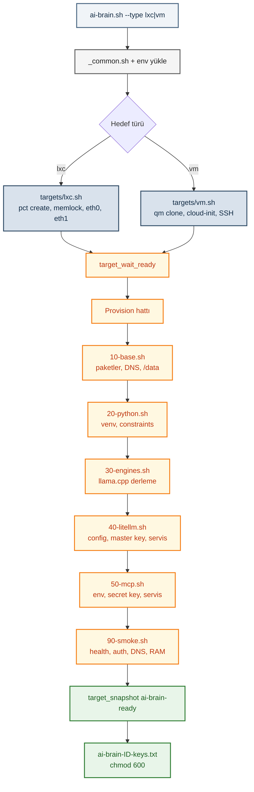
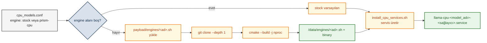
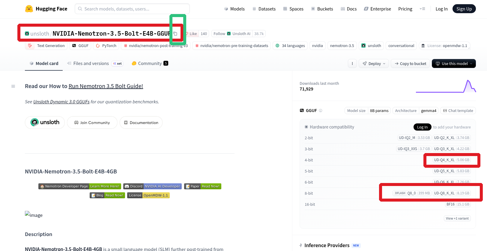
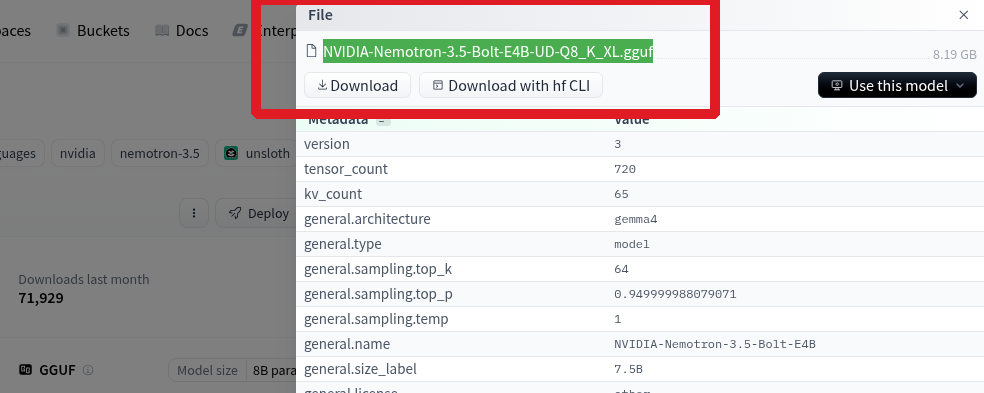
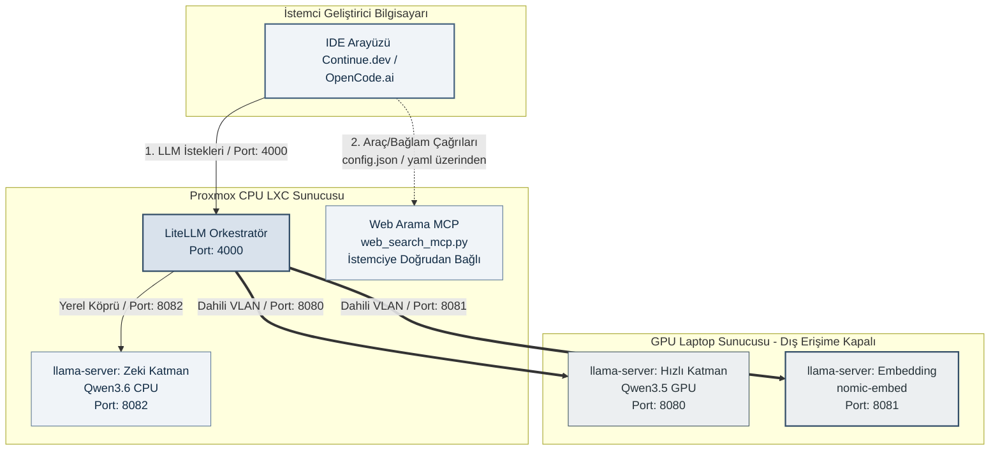
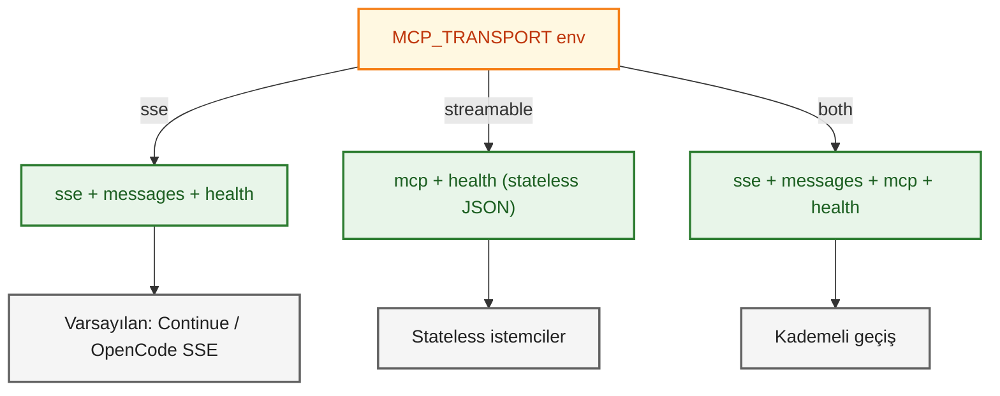

# YEREL YAPAY ZEKA GELİŞTİRME LABORATUVARI

## 3 Cihazlı, LiteLLM Orkestrasyonlu, Tam İzole, CUDA 11.7 Uyumlu ve Optimize Sistem Kılavuzu

Bu rehber; kısıtlı donanım kaynaklarını (eski bir GPU laptop ve Proxmox tabanlı bir CPU sunucusu) en yüksek verimle birleştirmeyi amaçlayan, ağ seviyesinde tam izole, kurumsal düzeyde güvenli ve güncel, Linux OS versiyon uyumsuzlukları giderilmiş, test edilmiş kurulum kılavuzudur. Farklı eski bilgisayarları tek bir yerel AI geliştirme altyapısında birleştirmek için hazırlanmıştır.

**Amaç:**

* Tamamen yerel çalışan
* OpenAI uyumlu API sunan
* VS Code / Continue.dev / opencode.ai ile entegre
* **MCP Web Search** ile güncel web erişimi *(v3: uygulandı, temel bileşen — bkz. D)*
* **RAG / kod tabanı arama** *(henüz uygulanmadı, opsiyonel — bkz. E)*
* İnternetten izole çalışabilen
* Düşük maliyetli ama profesyonel

bir geliştirme laboratuvarı oluşturmaktır.

> **📦 Bu Sürümde [v3]:**
>
> * **CPU sunucu tarafı AI-Brain otomasyonuna taşındı:** LXC/VM hedef desteği, llama.cpp engine profilleri (fork/branch esnekliği), env tabanlı yapılandırma ve otomatik duman testleri (bkz. B.2).
> * **MCP Web Search** artık **temel bileşen** olarak tek komutla kurulur (bkz. D).
> * **Klasör yapısı:** Otomasyon, provision modülleri ve payload dosyaları `v3/aibrain/` altındadır (bkz. B.2.1). GPU tarafı scriptleri `v2/scripts/gpu-side/`, istemci konfigürasyonları `v2/configs/` altında geçerliliğini korur. Bu belge dosya içeriklerini değil, **neyin nerede olduğunu ve nasıl kullanılacağını** anlatır.
> * **Hızlı başlangıç:** [`v3/Quick_start.md`](Quick_start.md)

> **⚠️ Donanım Güvenlik Uyarısı:** Bellek kısıtları nedeniyle, `switch` komutu hedef modeli ayağa kaldırmadan önce çalışan diğer tüm `llama-` servislerini otomatik olarak güvenli bir şekilde durdurur. Manuel olarak aynı anda birden fazla ağır model açılmaya çalışılmamalıdır; aksi takdirde sunucu kilitlenebilecektir.

<details>
<summary>İçindekiler</summary>


- [YEREL YAPAY ZEKA GELİŞTİRME LABORATUVARI](#yerel-yapay-zeka-geli̇şti̇rme-laboratuvari)
  - [3 Cihazlı, LiteLLM Orkestrasyonlu, Tam İzole, CUDA 11.7 Uyumlu ve Optimize Sistem Kılavuzu](#3-cihazlı-litellm-orkestrasyonlu-tam-i̇zole-cuda-117-uyumlu-ve-optimize-sistem-kılavuzu)
- [A — GENEL MİMARİ](#a-—-genel-mi̇mari̇)
  - [A-1 MİMARİ MANTIĞI](#a-1-mi̇mari̇-mantiği)
  - [A-2 Ağ İzolasyon Stratejisi](#a-2-ağ-i̇zolasyon-stratejisi)
    - [A-2.1 Proxmox Tarafı Altyapı Yapılandırması (VLAN Destekli)](#a-21-proxmox-tarafı-altyapı-yapılandırması-vlan-destekli)
    - [A-2.2 CachyOS (GPU Laptop) Tarafı Ağ İzolasyonu (VLAN Yapılandırması)](#a-22-cachyos-gpu-laptop-tarafı-ağ-i̇zolasyonu-vlan-yapılandırması)
- [B — KURULUMLAR](#b-—-kurulumlar)
  - [B.1 — GPU SUNUCU KURULUMU (Laptop 1 — CachyOS xfce4)](#b1-—-gpu-sunucu-kurulumu-laptop-1-—-cachyos-xfce4)
    - [B.1.1 CachyOS Ortamında Kurulum ve Temel Ayarlar](#b11-cachyos-ortamında-kurulum-ve-temel-ayarlar)
    - [B.1.2 Llama.cpp Derleme (Standart GCC ve Doğrudan CUDA Yolları) (GPU Build)](#b12-llamacpp-derleme-standart-gcc-ve-doğrudan-cuda-yolları-gpu-build)
    - [B.1.3 Model İndirme](#b13-model-i̇ndirme)
    - [B.1.4 Systemd Servislerinin Yapılandırılması (GPU Laptop)](#b14-systemd-servislerinin-yapılandırılması-gpu-laptop)
  - [B.2 — CPU SUNUCU KURULUMU (Proxmox LXC/VM — Debian 13) [v3: AI-Brain Otomasyonu]](#b2-—-cpu-sunucu-kurulumu-proxmox-lxc/vm-—-debian-13-[v3-ai-brain-otomasyonu])
    - [B.2.1 AI-Brain Otomasyon Mimari ve Dizin Yapısı](#b21-ai-brain-otomasyon-mimari-ve-dizin-yapısı)
    - [B.2.1.1 [v3] Python Ortamı: Ayrı venv'ler, constraints.txt](#b211-[v3]-python-ortamı-ayrı-venvler-constraintstxt)
    - [B.2.2 Hedef ve Ortam Yapılandırması (env dosyaları)](#b22-hedef-ve-ortam-yapılandırması-env-dosyaları)
    - [B.2.3 Kurulum ve İşlem Modları (ai-brain.sh)](#b23-kurulum-ve-i̇şlem-modları-ai-brainsh)
    - [B.2.4 Engine Sistemi — llama.cpp Fork/Branch Desteği](#b24-engine-sistemi-—-llamacpp-fork/branch-desteği)
    - [B.2.5 Model Tanımları (cpu_models.conf) ve Model İndirme](#b25-model-tanımları-cpu_modelsconf-ve-model-i̇ndirme)
    - [B.2.6 Model Servisleri ve cpu-model-switch](#b26-model-servisleri-ve-cpu-model-switch)
    - [B.2.6.1 [v3] Kurulum Sonrası Servis Kontrolleri ve VM Template Seçenekleri](#b261-[v3]-kurulum-sonrası-servis-kontrolleri-ve-vm-template-seçenekleri)
    - [B.2.7 Performans Notları: Thread, ubatch ve mlock](#b27-performans-notları-thread-ubatch-ve-mlock)
    - [B.2.8 [v3] Yol Sözleşmesi (paths.env) — NFR-7, T11](#b28-[v3]-yol-sözleşmesi-pathsenv-—-nfr-7-t11)
  - [B.3 — LiteLLM API Gateway (Aynı CPU LXC'de)](#b3-—-litellm-api-gateway-aynı-cpu-lxcde)
    - [B.3.1 Konfigürasyon Şablonu](#b31-konfigürasyon-şablonu)
    - [B.3.2 v3 Notları](#b32-v3-notları)
    - [B.3.3 Servis Durumu](#b33-servis-durumu)
- [C — İSTEMCİ LAPTOP (Geliştirme Makinesi)](#c-—-i̇stemci̇-laptop-geliştirme-makinesi)
  - [C.1 VS Code + Continue.dev Kurulumu](#c1-vs-code-+-continuedev-kurulumu)
  - [C.2 Continue Konfigürasyonu](#c2-continue-konfigürasyonu)
  - [C.3 OpenCode.ai (Terminal / Desktop) Konfigürasyonu (İsteğe Bağlı)](#c3-opencodeai-terminal-/-desktop-konfigürasyonu-i̇steğe-bağlı)
- [D — WEB ARAMA ENTEGRASYONU — MCP Web Search Sunucusu *(Temel Bileşen, v3'te Otomatik Kurulur)*](#d-—-web-arama-entegrasyonu-—-mcp-web-search-sunucusu-*temel-bileşen-v3te-otomatik-kurulur*)
  - [D.1 Kurulum](#d1-kurulum)
  - [D.2 MCP Sunucusu (`/opt/ai_engine/web_search_mcp.py`)](#d2-mcp-sunucusu-`/opt/ai_engine/web_search_mcppy`)
    - [D.2.1 Yapı Görseli](#d21-yapı-görseli)
    - [D.2.2 Kod kısmı](#d22-kod-kısmı)
  - [D.3 7/24 Çalışacak MCP Sunucusu Systemd Servisi](#d3-7/24-çalışacak-mcp-sunucusu-systemd-servisi)
    - [D.3.1 [v3] Sertleştirilmiş Servis ve Güvenlik Katmanları](#d31-[v3]-sertleştirilmiş-servis-ve-güvenlik-katmanları)
- [E — KOD TABANI ARAMA (LanceDB + DuckDB) — *(Opsiyonel, Uygulanmadı)*](#e-—-kod-tabani-arama-lancedb-+-duckdb-—-*opsiyonel-uygulanmadı*)
- [F — TEST VE DOĞRULAMA](#f-—-test-ve-doğrulama)
- [G — API ANAHTARI MESELESİ](#g-—-api-anahtari-meselesi̇)
- [H — GÜNLÜK KULLANIM ÖZETİ [v3]](#h-—-günlük-kullanim-özeti̇-[v3])
- [TEKNİK ÖZET TABLOSU](#tekni̇k-özet-tablosu)
  - [Ek: Spec Referansı (AI-Brain LXC VM Destekli Kurulum Spesifikasyonu)](#ek-spec-referansı-ai-brain-lxc-vm-destekli-kurulum-spesifikasyonu)
  - [Sonuç](#sonuç)

</details>

---


# A — GENEL MİMARİ

```text
┌────────────────────────────────────────────┐
│ GPU SUNUCU (CachyOS Laptop, i7 4. nesil)   │
│ GTX 960M 4GB VRAM + 16GB RAM               │
│--------------------------------------------│
│ llama-server (qwen3.5-4b-reasoning GPU)    │
│ llama-server (Embedding)                   │
│ 10.10.10.3                                 │
└────────────────┬───────────────────────────┘
                 │ İzole AI Ağı
                 │ 10.10.10.X
┌────────────────▼───────────────────────────────────────────────────┐
│ CPU SUNUCU (i7, 4. nesil) (Proxmox LXC Debian 13)                  │
│ 32GB RAM (LXC 28GB)                                                │
│--------------------------------------------------------------------│
│ llama-server (Qwen3.6-35B-A3B-Claude-4.7-Opus-Reasoning-Distilled) │
│ LiteLLM Proxy                                                      │
│ MCP Web Search                                                     │
│ RAG (Planned)                                                      │
│ 10.10.10.2 / 192.168.1.50                                          │
└────────────────┬───────────────────────────────────────────────────┘
                 │ LAN
┌────────────────▼────────────────────────────┐
│ GELİŞTİRME LAPTOPU                          │
│ VS Code + Continue.dev / OpenCode.ai Desktop│
│---------------------------------------------│
│ Tek API: http://CPU_SUNUCU:4000/v1          │
└─────────────────────────────────────────────┘
```

---

## A-1 MİMARİ MANTIĞI

Sistem, modelleri yeteneklerine, hızlarına ve bellek gereksinimlerine göre ayırarak **"Hiyerarşik Çıkarım (Hierarchical Inference)"** mantığıyla çalışır:

* **Hızlı Katman (GPU Laptop — CachyOS xfce4):** GTX 960M (4GB VRAM) üzerinde çalışan `Qwen3.5-4B-Claude-4.6-Opus-Reasoning-Distilled-GGUF` kod tamamlama (autocomplete) modeli. Tamamen VRAM'de kaldığı için anlık tepki süresi tatmin edici seviyede denebilir. Model thinking de yapabilmektedir.
* **Zeki Katman (CPU Sunucu — Proxmox LXC Debian 13):** 32GB RAM üzerinde 28GB'lık kısımda koşan `Qwen3.6-35B-A3B-Claude-4.7-Opus-Reasoning-Distilled-APEX-MTP-GGUF` karmaşık akıl yürütme (reasoning) ve derin analiz modeli.
* **Orkestrasyon ve Güvenlik Kapısı (LiteLLM Proxy):** İstemcinin hangi makineye bağlanacağını düşünmesine gerek kalmadan tek bir API arkasından modelleri ve istekleri yöneten akıllı yönlendirici.
* **İstemci Makine (Geliştirme Bilgisayarı):** Sadece VS Code ve Continue.dev eklentisini ya da Opencode.ai Terminal / Desktop çalıştırır. Üzerinde hiçbir model yükü barındırmaz.

> GTX 960M gibi eski kartlarda 7B modeller VRAM sınırına çok yaklaştığı için pratik kullanımda 3B/4B modeller daha stabil çalışır. `--parallel 1` kullanılması özellikle 4GB VRAM kartlarda OOM hatalarını önlemek için önemlidir. **Donanım detayları ve CUDA sürüm gereksinimi için bkz. B.1.**

---

## A-2 Ağ İzolasyon Stratejisi



Mevcut ev/ofis ağının `192.168.1.X` bloğunda internete açık olduğunu varsayalım. Güvenliği sağlamak adına internete hiç çıkışı olmayan, tamamen izole ikinci bir yapay ağ (`10.10.10.X`) oluşturulur. GPU Laptop bu ağda ana ağ geçidi (Gateway) boş bırakılarak hapsedilir. Proxmox LXC ise çift ağ bacaklı olarak yapılandırılır: bir bacağı internete (MCP servisleri ve güncellemeler için), diğer bacağı ise sadece GPU laptop ile konuşan izole ağa bakar. Dışarıdaki modem bu bloğu tanımadığı için veri sızıntısı fiziksel olarak imkânsız hale gelir.

> **[v3]** Yukarıdaki LXC ağ yapılandırması (eth0 ana ağ + eth1 VLAN izole ağ, gateway olmadan) v3'te `ai-brain.sh` kurulumu sırasında **otomatik** yapılır: `pct create --net0/--net1` ve VLAN tag'i env dosyasından okunur. `mlock` mekanizması için bkz. **B.2.7**. Elle ağ kurulumuna yalnızca otomasyon dışına çıkarsanız ihtiyaç duyarsınız.

### A-2.1 Proxmox Tarafı Altyapı Yapılandırması (VLAN Destekli)

Fiziksel dünyadaki tek portlu harici GPU laptopumuz ile Proxmox sunucumuzu ekstra bir ağ kablosu çekmeden, modem üzerindeki aynı hat üzerinden güvenle konuşturabilmek için ana sanal anahtarımızı (`vmbr0`) sanal odalara (VLAN) bölecek şekilde yapılandırıyoruz.

#### Adım 1: Proxmox Web Arayüzünden Ana Köprüyü "VLAN Aware" Yapma

1. Proxmox VE paneline giriş yapın.
2. Sol menüden ana sunucu ismine tıklayın, ardından **Network (Ağ)** sekmesine gelin.
3. Mevcut internete/modeme bağlı olan ana köprüyü (**`vmbr0`**) seçip üstteki **Edit** butonuna basın.
4. Açılan pencerede **VLAN Aware** seçeneğinin yanındaki kutucuğu işaretleyerek aktif hale getirin.
5. **OK** butonuna basın. Ardından üst menüde beliren **Apply Configuration** butonuna tıklayarak ağ değişikliklerini aktif hale getirin.

#### Adım 2: Proxmox LXC (LiteLLM Sunucusu) Çift Kart Ayarı (VLAN Tag ile)

Model yönetimini ve orkestrasyonunu üstlenen LXC container'ımıza, internet bacağını bozan `eth0` bacağına dokunmadan, ortak fiziksel hattan `VLAN 10` etiketiyle geçecek izole bir ikinci network kartı (`eth1`) ekleyeceğiz.

1. Proxmox sol menüsünden LiteLLM container'ınızı seçin.
2. Orta menüden **Network (Ağ)** sekmesine gelin.
3. **Add (Ekle)** butonuna basın ve parametreleri tam olarak şu şekilde doldurun:
   * **Name:** `eth1` *(Mevcut internet kartınız muhtemelen `eth0` olarak kayıtlıdır)*
   * **Bridge:** `vmbr0` *(VLAN Aware yaptığımız ana sanal anahtar)*
   * **VLAN Tag:** `10` *(Fiziksel dünyadaki trafiği ev internetinden ayırıp izole AI tüneline sokan kritik nokta burasıdır)*
   * **IPv4:** `Static` seçeneğini işaretleyin.
   * **IPv4/CIDR:** `10.10.10.2/24` yazın.
   * **Gateway (IPv4):** *KESİNLİKLE BOŞ BIRAKIN* *(Bu bacağın internete sızmaması ve yönlendirmesi olmaması için boş kalmalıdır)*
4. **Create** butonuna basarak kartı ekleyiniz.
5. Değişikliklerin işletim sistemi tarafından tanınması için LXC container'ı kapatıp yeniden başlatın (Reboot).

> Artık `eth0` dış dünyaya bakarken, `eth1` fiziksel ethernet kablonuzun içinden süzülen sadece `VLAN 10` etiketli `10.10.10.X` yapay zeka paketlerini dinleyecektir. CachyOS GPU laptop tarafında da ağ kartına `VLAN 10` kimliği ile `10.10.10.3/24` IP'si el ile (manual) tanımlanarak köprü tamamlanacaktır.

### A-2.2 CachyOS (GPU Laptop) Tarafı Ağ İzolasyonu (VLAN Yapılandırması)

Laptopumuz **ağa tek bir ethernet kablosu ile bağlı** olsa da, ortak hattan geçen paketleri ayırmak ve izole ağa dahil olabilmek için NetworkManager üzerinde `VLAN 10` etiketine sahip sanal bir ağ bacağı oluşturacağız. Ardından UFW ile bu bacağı tamamen dış dünyaya kapatacağız.

#### Adım 1: Fiziksel Ağ Kartının Adını Öğrenme

```bash
ip link
```

*Çıktıda `enp3s0` veya `eth0` gibi bir isim göreceksiniz. Bu kılavuzda fiziksel kart adının **`enp3s0`** olduğunu varsayarak ilerleyeceğiz.*

#### Adım 2: NetworkManager (nmcli) ile İzole VLAN Bağlantısını Oluşturma

```bash


# VLAN 10 etiketli sanal bağlantı profilini oluşturun
sudo nmcli connection add type vlan con-name "AI-Izole-Baglanti" dev enp3s0 id 10 ipv4.method manual ipv4.addresses 10.10.10.3/24


# Oluşturulan yeni izole tüneli aktif hale getirin
sudo nmcli connection up "AI-Izole-Baglanti"
```

#### Adım 3: UFW Firewall ile Tam Ağ İzolasyonu (En Kritik Adım)

```bash


# 1. Mevcut UFW kurallarını sıfırlayarak temiz bir başlangıç yapın
sudo ufw --force reset


# 2. Varsayılan politikaları kapatın (Her türlü giriş ve çıkışı tamamen engeller)
sudo ufw default deny incoming
sudo ufw default deny outgoing


# 3. Yerel döngü (Loopback - localhost) trafiğine izin verin
sudo ufw allow in on lo
sudo ufw allow out on lo


# 4. Proxmox LXC (LiteLLM) Sunucusu ile İletişim Kuralları
sudo ufw allow out to 10.10.10.2
sudo ufw allow in from 10.10.10.2


# 5. Güvenlik duvarını aktif edin
sudo ufw enable
```

#### Adım 4: Bağlantı ve İzolasyon Testi

1. **İzolasyon Testi (İnternet Kapalı Olmalı):** `ping 8.8.8.8` veya `ping google.com` komutunu çalıştırınız. UFW kuralları nedeniyle paketlerin kesinlikle dışarı çıkamaması ve hata vermesi gerekir.
2. **AI Tüneli Testi (Proxmox Bağlantısı Açık Olmalı):** `ping 10.10.10.2` komutunu çalıştırarak Proxmox üzerindeki LiteLLM container'ına erişebildiğinizi doğrulayın.

---


[⬆ Başa dön](#i̇çindekiler)

# B — KURULUMLAR

## B.1 — GPU SUNUCU KURULUMU (Laptop 1 — CachyOS xfce4)

> Donanım özeti ve rol dağılımı için bkz. **A-1**.

### B.1.1 CachyOS Ortamında Kurulum ve Temel Ayarlar

```bash


# Sistemi güncelle
sudo pacman -Syu


# Geliştirme araçları
sudo pacman -S base-devel git cmake ninja curl wget python python-pip


# NVIDIA sürücüsü (GTX 960M = Maxwell = nvidia-470xx)
sudo pacman -S nvidia-470xx-dkms nvidia-470xx-utils


# Not: CachyOS hızlı kernel güncellerse sürücü derlenemeyebilir.


#       O zaman linux-lts çekirdeğini kurup onunla başlatmak çözüm olur.


# önemli not: paru veya yay gibi bir AUR yardımcısının sistemde kurulu olması gerekir.
paru -S cuda-11.7
```

**Doğrulama:** `nvidia-smi`

```text
❯ nvidia-smi
Tue Jun  2 00:14:12 2026
+-----------------------------------------------------------------------------+
| NVIDIA-SMI 470.256.02   Driver Version: 470.256.02   CUDA Version: 11.4     |
|-------------------------------+----------------------+----------------------+
| GPU  Name        Persistence-M| Bus-Id        Disp.A | Volatile Uncorr. ECC |
| Fan  Temp  Perf  Pwr:Usage/Cap|         Memory-Usage | GPU-Util  Compute M. |
|===============================+======================+======================|
|   0  NVIDIA GeForce ...  Off  | 00000000:01:00.0 Off |                  N/A |
| N/A   45C    P0    N/A /  N/A |   3036MiB /  4046MiB |      0%      Default |
+-------------------------------+----------------------+----------------------+
| Processes:                                                                  |
|    0   N/A  N/A       851      C   ...pp/build/bin/llama-server      277MiB |
|    0   N/A  N/A       889      G   /usr/lib/Xorg                       2MiB |
|    0   N/A  N/A     85736      C   ...pp/build/bin/llama-server     2753MiB |
+-----------------------------------------------------------------------------+
```

#### B.1.1.1 CUDA Ortam Değişkenleri

`~/.zshrc` (veya `~/.bashrc`) dosyanızın en altına:

```bash
export CUDA_HOME=/opt/cuda-11.7
export PATH=$PATH:$CUDA_HOME/bin
export LD_LIBRARY_PATH=$LD_LIBRARY_PATH:$CUDA_HOME/lib64
```

Terminali yenileyin: `source ~/.zshrc` · Kontrol: `which nvcc`

#### B.1.1.2 Glibc / CUDA Uyumsuzluğu Düzeltmesi

Eski NVIDIA sürücüleri (örn: v470) ve eski GPU mimarileri (örn: Maxwell / GTX 960M) nedeniyle sistemde **CUDA 11.7** kullanılması zorunlu olabilir. Ancak güncel Arch Linux dağıtımlarındaki **Glibc (GNU C Library)** sürümü, `cospi`, `sinpi` ve `rsqrt` fonksiyonlarını `noexcept` kuralıyla güncellemiştir. CUDA 11.7'nin iç kütüphanelerinde bu kural eksik olduğu için, `llama.cpp` gibi projeleri `CMake` ile derlerken derleyici uyumsuzluk hatası (`exception specification is incompatible`) verir ve çöker.

Yedek alın:

```bash
sudo cp \
/opt/cuda-11.7/targets/x86_64-linux/include/crt/math_functions.h \
/opt/cuda-11.7/targets/x86_64-linux/include/crt/math_functions.h.bak
```

Dosyayı düzenleyin: `sudo nano /opt/cuda-11.7/targets/x86_64-linux/include/crt/math_functions.h`

> ⚠️ **Önemli Not:** Satır başlarındaki boşlukları, `extern` makrolarını veya sondaki noktalı virgülleri kesinlikle silmeyiniz. Sadece araya `noexcept` sıkıştırınız.

###### A. cospi ve cospif Grubu

```cpp
// Eski:
extern __DEVICE_FUNCTIONS_DECL__ __device_builtin__ double                 cospi(double x);
extern __DEVICE_FUNCTIONS_DECL__ __device_builtin__ float                  cospif(float x);
// Yeni:
extern __DEVICE_FUNCTIONS_DECL__ __device_builtin__ double                 cospi(double x) noexcept;
extern __DEVICE_FUNCTIONS_DECL__ __device_builtin__ float                  cospif(float x) noexcept;
```

###### B. sinpi ve sinpif Grubu

```cpp
// Eski:
extern __DEVICE_FUNCTIONS_DECL__ __device_builtin__ double                 sinpi(double x);
extern __DEVICE_FUNCTIONS_DECL__ __device_builtin__ float                  sinpif(float x);
// Yeni:
extern __DEVICE_FUNCTIONS_DECL__ __device_builtin__ double                 sinpi(double x) noexcept;
extern __DEVICE_FUNCTIONS_DECL__ __device_builtin__ float                  sinpif(float x) noexcept;
```

###### C. rsqrt ve rsqrtf Grubu

```cpp
// Eski:
extern __DEVICE_FUNCTIONS_DECL__ __device_builtin__ double                 rsqrt(double x);
extern __DEVICE_FUNCTIONS_DECL__ __device_builtin__ float                  rsqrtf(float x);
// Yeni:
extern __DEVICE_FUNCTIONS_DECL__ __device_builtin__ double                 rsqrt(double x) noexcept;
extern __DEVICE_FUNCTIONS_DECL__ __device_builtin__ float                  rsqrtf(float x) noexcept;
```

### B.1.2 Llama.cpp Derleme (Standart GCC ve Doğrudan CUDA Yolları) (GPU Build)

```bash
cd ~
git clone https://github.com/ggml-org/llama.cpp
cd llama.cpp
```

GLIBC `math_functions.h` yaması yapıldıktan sonra sistemdeki güncel **standart GCC derleyicisi** tamamen uyumlu hale gelmektedir. Clang derleyicisine veya paket düşürmeye (downgrade) gerek yoktur.

```bash
rm -rf build


# CUDA aktif, Maxwell mimari hedefi
cmake -B build \
  -DGGML_CUDA=ON \
  -DCMAKE_CUDA_COMPILER=/opt/cuda-11.7/bin/nvcc \
  -DCUDAToolkit_ROOT=/opt/cuda-11.7 \
  -DCMAKE_CUDA_ARCHITECTURES="50;52" \
  -DCMAKE_BUILD_TYPE=Release

#veya değişkenleri zaten görüyor ise:
cmake -B build \
  -DGGML_CUDA=ON \
  -DCMAKE_CUDA_ARCHITECTURES="50;52" \
  -DCMAKE_BUILD_TYPE=Release


# Derleme — $(nproc) mevcut CPU çekirdek sayısını otomatik algılar
cmake --build build --config Release -j$(nproc)
```

### B.1.3 Model İndirme

#### B.1.3.1 Dizinler

```bash
mkdir -p ~/models/coder
mkdir -p ~/models/embedding
```

#### B.1.3.2 HuggingFace CLI

```bash
pip install huggingface-hub


# -->  if not work / çalışmazsa
sudo pacman -S python-pipx
pipx install "huggingface_hub[cli]"
pipx ensurepath
source ~/.zshrc
```

#### B.1.3.3 GPU Kod Modeli (Hızlı coder)

```bash


# GPU kod modeli (Qwen2.5-Coder-3B)
hf download Qwen/Qwen2.5-Coder-3B-Instruct-GGUF qwen2.5-coder-3b-instruct-q4_k_m.gguf --local-dir ~/models/coder


# İsteğe bağlı diğer GPU modelleri (örnek)
hf download Jackrong/Qwen3.5-4B-Claude-4.6-Opus-Reasoning-Distilled-GGUF qwen3.5-4b-reasoning-q4_k_m.gguf --local-dir ~/models/coder
hf download ermiaazarkhalili/Granite-4.1-3B-SFT-Claude-Opus-Reasoning-Unsloth granite-4.1-3b-reasoning-q4_k_m.gguf --local-dir ~/models/coder
hf download nvidia/NVIDIA-Nemotron-3-Nano-4B-GGUF Nemotron-3-Nano-4B-Q4_K_M.gguf --local-dir ~/models/coder
```

#### B.1.3.4 Embedding Modeli (CPU)

```bash
hf download \
  nomic-ai/nomic-embed-text-v1.5-GGUF \
  nomic-embed-text-v1.5.Q4_K_M.gguf \
  --local-dir ~/models/embedding
```

### B.1.4 Systemd Servislerinin Yapılandırılması (GPU Laptop)

Süreçlerin arka planda kütüphane çakışması yaşamadan çalışması ve kolay yönetilebilmesi açısından sistem servisleri hazırlanmalıdır. `Environment=` satırları kütüphane yollarını açıkça göstererek olası çökmeleri engeller.

#### B.1.4.1 Coder Servisi (GPU, Port 8080)

##### B.1.4.1-A GPU Modelleri için Konfigürasyon (`gpu_models.conf`)

Tüm GPU modelleri **tek bir konfigürasyon dosyası** ile tanımlanır: `~/gpu_models.conf`. Format:

```ini
model_adı:qwen2.5-coder-3b
model_dosya:qwen2.5-coder-3b-instruct-q4_k_m.gguf
port:8080
gpu_katman:33
ctx_size:8192
threads:4
hf_repo:Qwen/Qwen2.5-Coder-3B-Instruct-GGUF
extra_params:--flash-attn on
```

* Zorunlu alanlar: `model_adı`, `model_dosya`, `port`, `hf_repo`.
* İsteğe bağlı: `gpu_katman` (varsayılan 33), `ctx_size` (8192), `threads` (4), `extra_params`.
* Tam örnek: `../v2/scripts/gpu-side/gpu_models.conf`.

> **Önemli not:** GPU tarafında tüm alternatif modeller **aynı porttan (8080)** kalkacak şekilde ayarlanmıştır; LiteLLM tarafında değişiklik gerekmez. İstenildiği zaman conf dosyasından port kısmı değiştirilebilir.

##### B.1.4.1-B GPU Servis Kurulum Scripti (`install_gpu_services.sh`)

Script:
* `gpu_models.conf` dosyasını okur.
* Her model için `/etc/systemd/system/llama-gpu-<model_adı>-<sağlayıcı>.service` dosyasını oluşturur/günceller.
* `/usr/local/bin/gpu-model-switch` aracını oluşturur/günceller.

**Önemli Not:** Script içindeki `ai-gpu` kullanıcısı **placeholder**'dır — kendi `kullanıcı adınız`la değiştiriniz veya `User=`/`Group=` satırlarını uyarlayınız/kaldırınız. Detaylar için `../v2/scripts/gpu-side/install_gpu_services.sh` ve `../v2/scripts/gpu-side/README.md`.

```bash
chmod +x install_gpu_services.sh
sudo ./install_gpu_services.sh
```

##### B.1.4.1-C GPU Model Switch Aracı (`gpu-model-switch`)

```bash
gpu-model-switch list          # mevcut modelleri göster
gpu-model-switch status        # hangi model aktif?
gpu-model-switch switch qwen3.5-4b   # geçiş yap
```

Script, geçişten önce çalışan tüm GPU servislerini durdurur (4GB VRAM'de aynı anda tek model çalışabilir), bekler ve yeni modeli kaldırır.

#### B.1.4.2 Embedding Servisi (CPU, Port 8081) (`/etc/systemd/system/llama-embed.service`)

```bash
sudo tee /etc/systemd/system/llama-embed.service << 'EOF'
[Unit]
Description=Llama.cpp Embedding Service
After=network.target

[Service]
Type=simple
User=ai-gpu
Group=ai-gpu
WorkingDirectory=/home/ai-gpu/llama.cpp
Environment="LD_LIBRARY_PATH=/opt/cuda-11.7/lib64:/opt/cuda-11.7/targets/x86_64-linux/lib"
Environment="PATH=/opt/cuda-11.7/bin:/usr/local/sbin:/usr/local/bin:/usr/sbin:/usr/bin:/sbin:/bin"
ExecStart=/home/ai-gpu/llama.cpp/build/bin/llama-server \
  --model /home/ai-gpu/models/embedding/nomic-embed-text-v1.5.Q4_K_M.gguf \
  --host 10.10.10.3 --port 8081 \
  --embedding --ctx-size 2048 --threads 8
Restart=always

[Install]
WantedBy=multi-user.target
EOF

sudo systemctl enable --now llama-embed
```

#### B.1.4.3 Servisleri Başlat

```bash
gpu-model-switch switch qwen2.5-coder-3b    # GPU modeli
sudo systemctl daemon-reload
sudo systemctl enable --now llama-embed.service
```

Durum kontrolü:

```bash
gpu-model-switch status
sudo systemctl status llama-embed
```

#### B.1.4.4 `libcudart` Hatası Çözümü

```bash
sudo ln -sf /opt/cuda-11.7/lib64/libcudart.so.11.7.99 /opt/cuda-11.7/lib64/libcudart.so.11.0
sudo ln -sf /opt/cuda-11.7/lib64/libcudart.so.11.7.99 /opt/cuda-11.7/lib64/libcudart.so.11.7
sudo systemctl daemon-reload
sudo systemctl restart llama-embed
```

---

## B.2 — CPU SUNUCU KURULUMU (Proxmox LXC/VM — Debian 13) [v3: AI-Brain Otomasyonu]

> **v3:** Elle tek tek kurulum adımları (LXC oluşturma, paket kurulumu, elle llama.cpp derleme, elle servis kurulumu) bu sürümden kaldırılmıştır. CPU sunucu (LXC veya Cloud-Init VM), llama.cpp derlemesi, LiteLLM ve MCP servisleri tek komutla **AI-Brain otomasyonu** ile kurulur. Elle kurulum için **[`../v2/homelab-ai-setups_v2.md`](../v2/homelab-ai-setups_v2.md) — B.2**.

**LXC (Linux Container)** `cpu=host` olarak ayarlandığında işletim sistemi çekirdeğini host ile paylaşır, sadece kullanıcı alanını izole eder. Sonuç: bare-metal'a %95 yakın performans, ama yine de güvenli izolasyon. 32GB RAM'in tamamını modele verebilirsiniz, ama iyi olanı 28GB civarı olacaktır. Burada hem büyük kod modeli hem de LiteLLM proxy ve web_search_mcp server çalışacak.

### B.2.1 AI-Brain Otomasyon Mimari ve Dizin Yapısı

AI-Brain, Proxmox VE üzerinde CPU tabanlı çıkarım altyapısını (llama.cpp + LiteLLM + MCP) tek komutla hem **LXC** hem de **Cloud-Init VM** hedeflerinde kuran modüler bash otomasyonudur.

```text
ai-brain/
├── ai-brain.sh                 # Ana giriş noktası (--type lxc|vm, --update, --dry-run)
├── _common.sh                  # Ortak kütüphane: SSH, loglama, env yükleme, varsayılanlar
├── .ai-brain-lxc.env.example   # LXC hedefi için örnek yapılandırma
├── .ai-brain-vm.env.example    # VM hedefi için örnek yapılandırma
├── targets/                    # Hedef arka uçları
│   ├── lxc.sh                  # pct komutları, Debian 13 template indirme, snapshot
│   └── vm.sh                   # qm clone (cloud-init), paylaşımlı SSH (ControlMaster)
├── provision/                  # Sıralı kurulum hattı (sırayla source edilir)
│   ├── 10-base.sh              # Paketler, disk genişletme, locale, /data, erişim kullanıcısı
│   ├── 20-python.sh            # İzole venv'ler (/opt/ai_engine, /opt/litellm) + doğrulama
│   ├── 30-engines.sh           # Engine profilleri + llama.cpp derleme
│   ├── 40-litellm.sh           # LiteLLM config, master key, servis
│   ├── 50-mcp.sh               # MCP env, secret key, sertleştirilmiş servis
│   └── 90-smoke.sh             # Kurulum sonu duman testleri
├── payload/                    # Hedefe aktarılan dosyalar
│   ├── paths.env               # Dizin/yol sözleşmesi
│   ├── constraints.txt         # Sabit Python paket sürümleri
│   ├── engines/                # llama.cpp engine profilleri (stock.sh, prism-cpu.sh)
│   ├── cpu_models.conf         # Model tanımları
│   ├── install_cpu_services.sh # Servis üretici + cpu-model-switch
│   ├── litellm-config.yml      # LiteLLM şablonu ({{LITELLM_MASTER_KEY}})
│   ├── litellm.service         # Sertleştirilmiş systemd birimi
│   ├── mcp-web-search.env      # MCP env şablonu ({{MCP_SECRET_KEY}})
│   ├── mcp-web-search.service  # Sertleştirilmiş systemd birimi
│   ├── web_search_mcp.py       # MCP 2.x Web Search sunucusu
│   └── mcp_verify.py           # Kurulum içi MCP doğrulama scripti
└── tools/                      # Operasyonel yardımcılar
    ├── create-vm-template.sh   # Cloud-Image tabanlı VM template üretici (Debian/Ubuntu/Rocky/Alma)
    ├── status.sh               # 6 bölümlü durum/sağlık raporu
    ├── rotate-keys.sh          # LiteLLM + MCP anahtar yenileme
    ├── discover-pve.sh         # Proxmox ağ/depolama keşfi
    └── setup-proxmox-token.sh  # Proxmox API token kurulumu (opsiyonel)
```



> **[v3] venv yolları (hedefte üretilir, repoda yok):**
> * `/opt/ai_engine/venv` → MCP Web Search
> * `/opt/litellm/venv` → LiteLLM Proxy
>
> `20-python.sh`, `python3 -m venv` ile her iki venv'i oluşturur; `constraints.txt` ile sürüm sabitler. `--break-system-packages` kullanılmaz. **Detaylı gerekçe için bkz. B.2.1.1.**

**Hedef arka uç işlemleri (LXC ve VM ortak arayüz):** Provision kodu hedef türünü bilmez; yalnızca bu beş işlemi kullanır (NFR-6: yeni hedef türü eklemek provision kodunu değiştirmez).

| İşlem | LXC uygulaması | VM uygulaması |
|---|---|---|
| `target_create` | `pct create`, memlock ayarı, eth0/eth1 ağ | Şablondan `qm clone`, cloud-init (IP, kullanıcı, SSH anahtarı, DNS), `qm start` |
| `target_wait_ready` | `pct exec ... true` döngüsü | SSH bağlantısı ve cloud-init bitişi beklenir |
| `target_exec <komut>` | `pct exec` | `ssh` |
| `target_push <yerel> <uzak> <mod>` | `pct push` | `scp` |
| `target_destroy` | `pct stop` ve `pct destroy` | `qm stop` ve `qm destroy` |

**Neden bu soyutlama?** Aynı provision kodu hem LXC hem VM'de değişmeden çalışır (FR-4); uzak mantık heredoc'tan çıkarılırken davranış sessizce değişmez (spec Risk).

**Çalışma mantığı:** `ai-brain.sh` → `_common.sh` ve hedefe özel `.ai-brain-*.env` yükler → hedef arka ucunu seçer (`targets/lxc.sh` veya `vm.sh`) → hedefi oluşturur → provision modüllerini sırayla çalıştırır → başarılı kurulumda `ai-brain-ready` snapshot'ı alır → anahtarları `ai-brain-<ID>-keys.txt` dosyasına (chmod 600) yazar.

### B.2.1.1 [v3] Python Ortamı: Ayrı venv'ler, constraints.txt

v3'te paketler sistem Python'una **kurulmaz**; her bileşen kendi izole venv'inde çalışır. Nedenleri:

* **Sistem paketlerini kirletmemek:** Proxmox/LXC temel sistemi ile AI paketleri (mcp, litellm, fastapi vb.) birbirinden izole edilir; apt yükseltmeleri AI servislerini bozmaz.
* **SDK çakışmasını önlemek:** `mcp` 2.x (MCP sunucusu) ile LiteLLM'in dahili MCP SDK sabitlemesi farklı sürümler isteyebilir. Ayrı venv'ler (`/opt/ai_engine/venv` ve `/opt/litellm/venv`) bu çakışmayı kökten çözer.
* **Tekrarlanabilirlik (NFR-3):** `constraints.txt` ile sabit sürümler; aynı girdi ile aynı kurulum.
* **Güvenlik:** venv dizinleri root'a ait, servisler venv binary'si ile çalışır; sistem Python'una yazma yetkisi gerekmez.

**Kurulum yöntemi:** `20-python.sh`, `python3 -m venv` ile her iki venv'i oluşturur, `pip install --upgrade pip setuptools wheel` ile pip'i günceller, ardından paketleri `constraints.txt` ile sabitlenmiş sürümlerde kurar. `uvloop` opsiyoneldir (yoksa asyncio ile devam eder).

> **Önemli:** Bu kural v3'ün tamamı için geçerlidir. Belgenin hiçbir yerinde `--break-system-packages` kullanılmamalıdır.

### B.2.2 Hedef ve Ortam Yapılandırması (env dosyaları)

```bash
cd v3/aibrain


# LXC hedefi için:
cp .ai-brain-lxc.env.example .ai-brain-lxc.env
nano .ai-brain-lxc.env


# VM hedefi için:
cp .ai-brain-vm.env.example .ai-brain-vm.env
nano .ai-brain-vm.env
```

> ⚠️ `.ai-brain-*.env` dosyaları **git'e commit edilmez** (`.gitignore` kapsamındadır).

**Önemli env alanları (LXC örneği):**

| Alan | Açıklama | Örnek |
| --- | --- | --- |
| `AI_PVE_IP` | Proxmox host adresi (zorunlu) | `164.102.98.16` |
| `AI_CT_ID` | CT/VM ID; boşsa `pvesh nextid` ile otomatik | `220` |
| `AI_MAIN_NET_MODE` | eth0 modu: `dhcp` \| `static` | `static` |
| `AI_MAIN_NET_IP` / `AI_MAIN_NET_GW` | static ise zorunlu | `164.102.98.90/32` / `164.102.98.70` |
| `AI_VLAN_TAG` / `AI_NET_IP` | eth1 izole ağ (gateway YOK — kasıtlı) | `10` / `10.10.10.2/24` |
| `AI_HOSTNAME` | Hedef adı | `ai-brain` |
| `AI_CORES` / `AI_MEMORY_MB` / `AI_DISK_GB` | Kaynaklar | `8` / `28672` / `120` |
| `AI_SWAP_MB` | Swap (VM'de 0) | `0` |
| `AI_DNS` | Hedef DNS sunucuları | `"1.1.1.1 9.9.9.9"` |
| `AI_SSH_PUBKEY_FILE` | SSH public key dosyası | `$HOME/.ssh/id_ed25519.pub` |
| `MCP_TRANSPORT` | `sse` \| `streamable` \| `both` | `sse` |

`--type lxc` ve `--host` gibi CLI parametreleri env değerlerinin üzerine yazar. Env'de tanımlı olmayan her alan `_common.sh` varsayılanlarına düşer (örn. 7 core, 28672 MB RAM, 100 GB disk, VLAN 10).

### B.2.3 Kurulum ve İşlem Modları (ai-brain.sh)


Önce planı doğrulayın (hiçbir şey yapmaz):

```bash
./ai-brain.sh --dry-run                 # LXC planı
./ai-brain.sh --type vm --dry-run       # VM planı
```

Kurulumu başlatın:

```bash
./ai-brain.sh --type lxc                # Proxmox LXC (Debian 13)
./ai-brain.sh --type vm                 # Proxmox Cloud-Init VM (Debian 13)
```

> **VM notu:** Proxmox'ta hazır Debian 13 Cloud-Init template yoksa, arka planda `tools/create-vm-template.sh` otomatik çalışır: resmi cloud imajı indirilir, SHA512 checksum doğrulanır, `qemu-guest-agent` first-boot'ta cloud-init ile kurulur ve şablon `qm template` ile template'e çevrilir. Elle ayrı bir adım gerekmez.

**LXC tarafında otomatik yapılanlar:** Debian 13 template indirme (`pveam`), unprivileged container oluşturma, eth0/eth1 ağ yapılandırması, host'ta `lxc.prlimit.memlock: unlimited`, DNS, temel paketler, disk genişletme (growpart/resize2fs), locale, `/data` dizin sözleşmesi.

**Sık kullanılan işlem modları:**

| Mod | Komut | Ne yapar |
| --- | --- | --- |
| Güncelleme | `./ai-brain.sh --update --ctid <ID> --host <IP>` | Hedefi silmeden config/kod/servisleri günceller; **anahtarları korur** |
| Yeniden kurulum | `./ai-brain.sh --force --ctid <ID>` | Mevcut hedefi silip üzerine kurar |
| Silme | `./ai-brain.sh --destroy --ctid <ID>` | Hedefi durdurur ve siler |
| Hata temizliği | `--cleanup-on-fail` | Kurulum hata verirse hedefi siler (varsayılan: korur) |
| Engine seçimi | `--engines stock,prism-cpu` | Belirtilen engine(ler)i derler |
| Derleme atlama | `--skip-llama-build` | llama.cpp derlemesini atlar |
| Erişim kurulumu | `--setup-access --ssh-pubkey-file <yol>` | `aibrain` kullanıcısı (NOPASSWD sudo) + SSH sertleştirme |

> **[v3] MCP devre dışı bırakma:** MCP Web Search v3'te **temel bileşendir**; `--skip-mcp` bayrağı yoktur. `provision/50-mcp.sh` her kurulumda çalışır ve `90-smoke.sh` MCP `/health` + kimlik doğrulama testlerini zorunlu tutar. İleride istenirse `--skip-mcp` bayrağı Faz 4 kapsamında eklenebilir; şu an için MCP olmadan kurulum desteklenmemektedir.

**Operasyonel araçlar (v3/aibrain/tools/):**

| Araç | Ne yapar |
|---|---|
| `status.sh --host <PVE_IP> --id <ID> [--type vm]` | 6 bölümlü durum/sağlık raporu (servisler, /health, LiteLLM, cpu-model-switch, RAM/disk, DNS) |
| `rotate-keys.sh --host <PVE_IP> --id <CT_ID>` | LiteLLM + MCP anahtar yenileme, servis restart, yerel dosya güncelleme |
| `discover-pve.sh` | Proxmox ağ/depolama keşfi (VM şablonu üretimi öncesi) |
| `setup-proxmox-token.sh` | Proxmox API token kurulumu (opsiyonel, en az yetkili) |
| `create-vm-template.sh` | Cloud-image tabanlı VM template üretici (Debian/Ubuntu/Rocky/Alma), `--dry-run`/`--force` destekli |

> VM hedeflerinde anahtar yenileme şu an yalnızca elle yapılmalıdır (`rotate-keys.sh` LXC için tam otomatiktir).

**Kurulum sonunda:**

```text
MCP Uç Noktası:  http://<Hedef-IP>:8000/sse
LiteLLM Proxy:   http://<Hedef-IP>:4000
Anahtarlar:      v3/aibrain/ai-brain-<ID>-keys.txt  (chmod 600)
```

### B.2.4 Engine Sistemi — llama.cpp Fork/Branch Desteği 

v3 ile birlikte hangi llama.cpp derlemesinin kullanılacağı **engine profilleri** ile tanımlanır. Her profil yalnızca değişken tanımlar, hiçbir komut çalıştırmaz:

yolu: [v3/aibrain/payload/engines](aibrain/payload/engines)

```ini


# payload/engines/stock.sh — mainline (ggml-org)
ENGINE_NAME="stock"
ENGINE_REPO_URL="https://github.com/ggml-org/llama.cpp"
ENGINE_CLONE_DIR="/opt/llama.cpp"
ENGINE_CMAKE_FLAGS="-DGGML_AVX2=ON -DGGML_F16C=ON -DGGML_FMA=ON -DGGML_CUDA=OFF \
  -DCMAKE_BUILD_TYPE=Release -DCMAKE_C_FLAGS=-march=native -DCMAKE_CXX_FLAGS=-march=native"
ENGINE_LLAMA_BIN="${ENGINE_CLONE_DIR}/build/bin/llama-server"
ENGINE_WORKDIR="${ENGINE_CLONE_DIR}/build"


# Opsiyonel: ENGINE_REF="v0.0.0"  → git checkout (branch/tag/commit pin desteği)
```

prism-ml:

```ini
#payload/engines/prism-cpu.sh

ENGINE_NAME="prism-cpu"
ENGINE_DESCRIPTION="PrismML-Eng/llama.cpp fork - ternary/dusuk-bit GGUF (Bonsai ailesi) icin CPU build"

ENGINE_REPO_URL="https://github.com/PrismML-Eng/llama.cpp"
ENGINE_CLONE_DIR="/opt/llama.cpp-prism"


# TODO: build oncesi Bonsai-demo repo'sundaki setup.sh / runtime tablosuna gore dogrula
ENGINE_CMAKE_FLAGS="-DGGML_AVX2=ON -DGGML_F16C=ON -DGGML_FMA=ON -DGGML_CUDA=OFF -DCMAKE_BUILD_TYPE=Release -DCMAKE_C_FLAGS=-march=native -DCMAKE_CXX_FLAGS=-march=native"

ENGINE_LLAMA_BIN="${ENGINE_CLONE_DIR}/build/bin/llama-server"
ENGINE_WORKDIR="${ENGINE_CLONE_DIR}/build"

```

**Mevcut profiller:**

| Engine | Repo | Amaç |
| --- | --- | --- |
| `stock` | ggml-org/llama.cpp (mainline) | Standart GGUF quant'ları (Q4_K_M, Q8_0, IQ* vb.) |
| `prism-cpu` | PrismML-Eng/llama.cpp (fork) | Ternary/düşük-bit GGUF (Bonsai ailesi: Q1_0_g128, PQ2_0 vb.) |

> ⚠️ PrismML fork'u deneyseldir; ternary format adlandırması zamanla değişebilir. Güncel runtime/format tablosu için [Bonsai-demo](https://github.com/PrismML-Eng/Bonsai-demo) reposu esas alınmalıdır.

**Yeni engine (fork/branch) ekleme — 3 adım:**

1. `payload/engines/` altına bir profil kopyalayın: `cp stock.sh my-fork.sh`
2. `ENGINE_NAME`, `ENGINE_REPO_URL`, `ENGINE_CLONE_DIR`, `ENGINE_CMAKE_FLAGS` değerlerini fork'unuza göre düzenleyin; belirli bir branch/tag için `ENGINE_REF` tanımlayın.
3. Kurulumu `--engines my-fork` ile çalıştırın (veya `--engines stock,my-fork`).

Ana scriptlere (`ai-brain.sh`, `install_cpu_services.sh`) **dokunmaya gerek yoktur**; `30-engines.sh` profilleri `/data/engines/`'e aktarır, `git clone --depth 1` + cmake ile derler. `cpu_models.conf` içindeki her model bloğu `engine:` alanı ile hangi derlemeyle çalışacağını belirtir (boşsa `stock` kullanılır; bilinmeyen engine adı hata verir).

> **Native binary taşınmazlık notu:** Native CPU bayraklarıyla (`-march=native`) derlenen binary, başka bir CPU'ya taşınamaz. Bu yüzden her makine kendi derlemesini yapar (engine profilleri `git clone` + `cmake` ile hedefte derlenir). Engine profili eklemek yalnızca yeni bir dosya eklemek anlamına gelir; ana scriptlere dokunmaya gerek yoktur.



### B.2.5 Model Tanımları (cpu_models.conf) ve Model İndirme

`/data/cpu_models.conf` dosyasında her model bir bloktur. **`install_cpu_services.sh`** bu dosyayı okur, her blok için **otomatik systemd servisi** üretir. Çıktı listesinde, modeller diskte yok ise conf daki bilgilere göre indirme linklerini de yazar.

**Alanlar:**

| Alan | Zorunlu | Varsayılan | Açıklama |
| --- | --- | --- | --- |
| `alias` | ✅ | — | `cpu-model-switch` komutunda kullanılacak kısa ad |
| `model_adı` | ✅ | — | Servis adı üretilirken kullanılır |
| `model_dosya` | ✅ | — | `/data/models/` altındaki GGUF dosya adı (alt klasör yolu da olur) |
| `hf_repo` | ✅ | — | HuggingFace repo'su (indirme talimatı için) |
| `port` | ❌ | `8080` | Servis portu (bkz. B.3.2 LiteLLM notu) |
| `ctx_size` | ❌ | `4096` | Bağlam boyutu |
| `threads` / `threads_batch` | ❌ | `4` / `4` | CPU thread sayıları |
| `engine` | ❌ | `stock` | `payload/engines/` altındaki profil adı |
| `mmproj_dosya` / `mmproj_repo` | ❌ | — | Vision-language modeller için `--mmproj` bayrağı |
| `draft_dosya` / `draft_repo` | ❌ | — | Speculative decoding draft modeli (`-md`) |
| `spec_type` | ❌ | — | `draft-dflash`, `draft-mtp` vb. (`--spec-type`) |
| `extra_params` | ❌ | — | Serbest llama-server bayrakları |

**Örnek blok:**

```ini
alias:qwen36-mudler-lordx64
model_adı:qwen3.6-35b
model_dosya:Qwen3.6-35B-A3B-Claude-4.7-Opus-Reasoning-Distilled-APEX-MTP-I-Compact.gguf
ctx_size:16384
threads:4
threads_batch:8
hf_repo:mudler/Qwen3.6-35B-A3B-Claude-4.7-Opus-Reasoning-Distilled-APEX-MTP-GGUF
extra_params:--ubatch-size 256 --batch-size 512 --parallel 1 --cache-type-k q8_0 --cache-type-v q4_0 --flash-attn on --jinja --spec-type draft-mtp --spec-draft-n-max 3
```

daha fazla değişken,parametre,komut ve kullanım örneği için bakabilirsiniz [v3/aibrain/payload/cpu_models.conf](aibrain/payload/cpu_models.conf).

#### B.2.5.1 [v3] cpu_models.conf'a Model Adı ve Repo Nasıl Eklenir

`cpu_models.conf`'taki `model_dosya` ve `hf_repo` alanları HuggingFace web arayüzünden alınır (örnek: `cpu_models.conf`'taki ilk model bloğu). `hf download` komut biçimi için bkz. **B.1.3.3**. Detaylı örnek kullanım ve alan açıklamaları için bkz. [v3/aibrain/payload/cpu_models.conf](aibrain/payload/cpu_models.conf).

**Adım 1 — Repo adını kopyalama:** HF repo sayfasının üstündeki repo adı (örn. `unsloth/NVIDIA-Nemotron-3.5-Bolt-E4B-GGUF`) kopyalanır ve `hf_repo:` alanına yazılır.



**Adım 2 — Model dosya adını alma:** Model listesindeki dosyaya tıklanınca sağ tarafta açılan panelde dosya adı (örn. `NVIDIA-Nemotron-3.5-Bolt-E4B-UD-Q8_K_XL.gguf`) görünür. Bu ad `model_dosya:` alanına yazılır. Dosya bir alt klasördeyse (örn. `MTP/`) yol `MTP/dosya-adı.gguf` biçiminde yazılır.



**Özet kural:**

```ini
alias:nv-nem-3.5-bolt-e4b-q8
model_adı:nv-nem-3.5-bolt-e4b-q8
model_dosya:NVIDIA-Nemotron-3.5-Bolt-E4B-UD-Q8_K_XL.gguf
hf_repo:unsloth/NVIDIA-Nemotron-3.5-Bolt-E4B-GGUF
```

* `hf_repo` = repo sayfasının üstündeki `kullanıcı/repo-adı` (tam yol).
* `model_dosya` = model listesindeki dosya adı (alt klasör varsa `klasör/dosya.gguf`).
* Draft/mmproj dosyaları için `draft_repo`/`mmproj_repo` ve `draft_dosya`/`mmproj_dosya` alanları aynı yöntemle doldurulur.

**Otomatik davranışlar ve kurallar:**

* Duplicate `alias` tespit edilirse kurulum **hata ile durur**; elle girilen portlar çakışırsa uyarılır (varsayılan 8080 ortak kullanıma açıktır).
* `spec_type`/`draft_dosya` verilirse `extra_params` içindeki elle yazılmış `--spec-type`/`-md` bayrakları **uyarıyla temizlenir** (çift bayrak üretilmez).
* `mmproj` + `draft/spec_type` birlikte kullanılırsa uyumluluk uyarısı verilir.
* Model dosyası yoksa **hem ana model hem de draft/mmproj dosyaları için** `hf download` talimatı otomatik üretilir:

```bash
hf download <hf_repo> <model_dosya> --local-dir /data/models
```

> **[v3] hf kurulumu gerekmez:** LiteLLM provision hattı (`20-python.sh`) içinde uyumlu `huggingface-hub` paketi kurulur ve `ln -sf /opt/litellm/venv/bin/hf /usr/local/bin/hf` ile symbolic link oluşturulur. Bu sayede `install_cpu_services.sh` çıktısında verilen `hf download ...` komutları **ekstra hf kurulumu olmadan** doğrudan çalışır. Ayrı bir `pip install huggingface-hub` adımı yoktur.

> **[v3] İndirme otomasyonu yok:** `install_cpu_services.sh` yalnızca `hf download <repo> <dosya> --local-dir /data/models` komutunu **üretir**; indirme kullanıcıya bırakılmıştır (disk kapasitesi ve model seçimi kullanıcı kararıdır). Kullanıcı komutu çalıştırmadan önce `df -h /data` ile boş alanı kontrol etmelidir.

**Alt klasör desteği:** `model_dosya` / `draft_dosya` / `mmproj_dosya` alanları HF repo'sundaki göreceli yolu ifade eder. Dosya repo içinde bir alt klasördeyse `MTP/dosya-adı.gguf` biçiminde yazmak yeterlidir — hem üretilen `hf download` talimatı hem de servis `ExecStart`'ındaki `-m /data/models/<yol>` doğru çalışır.

**Model seçim notu (DDR3 band genişliği):** Dense mimaride her token üretiminde modelin tüm ağırlıkları bellekten geçer; DDR3 1600 MHz çift kanal bant genişliği bu noktada tavan olur. `MoE (Mixture of Experts)` mimarisinde ise her token üretiminde yalnızca aktif uzman katmanları bellekten geçer — aynı RAM alanını tutsa da bu yüzden MoE modelleri bu sunucuda belirgin şekilde daha hızlıdır.

### B.2.6 Model Servisleri ve cpu-model-switch

Hedef içinde servisleri yönetmek için:

```bash
/data/install_cpu_services.sh        # cpu_models.conf'u okur, servisleri üretir
cpu-model-switch list                # Tüm modelleri ve portlarını listele
cpu-model-switch status              # Çalışma durumunu göster
cpu-model-switch switch <alias>      # Bir modele geç (diğerlerini durdurur)
cpu-model-switch stop                # Tüm CPU servislerini durdur
```

* Servisler `llama-cpu-<model_adı>-<sağlayıcı>.service` adıyla üretilir (`service_base` = `model_adı` + `hf_repo`'dan sağlayıcı).
* `--load-mode mlock` ve `TimeoutStartSec=600` ile büyük modeller RAM'e güvenle yüklenir.
* `cpu-model-switch`, geçişten önce çalışan tüm `llama-cpu-*` servislerini durdurur, bekler ve yenisini başlatır. Model geçişleri sadece bu araçla yapılır.
* Konfigürasyon (`cpu_models.conf`) değişince aynı `install_cpu_services.sh` komutunu tekrar çalıştırmak yeterlidir.

### B.2.6.1 [v3] Kurulum Sonrası Servis Kontrolleri ve VM Template Seçenekleri

**install_cpu_services.sh değişkenleri:**
- `CONFIG_FILE` (varsayılan: `/data/cpu_models.conf`) — model tanımları dosyası.
- `ENGINES_DIR` (varsayılan: `/data/engines`) — engine profilleri dizini.

Çalıştırma:
```bash
sudo /data/install_cpu_services.sh
sudo CONFIG_FILE=/data/cpu_models.conf ENGINES_DIR=/data/engines /data/install_cpu_services.sh
```

**VM template seçenekleri (`ai-brain.sh --type vm`):**
- `--no-auto-template` : şablon oluşturma adımını atla (hazır şablon varsa).
- `--template-id <id>` : kullanılacak şablon ID'sini belirt.
- `--virt-customize` : şablonu virt-customize ile özelleştir.

**Kontrol komutları (service checks):**
```bash


# Servis durumu (tek ekran)
./tools/status.sh --host <PVE_IP> --id <CTID/VMID>


# Canlı log
journalctl -u litellm -f
journalctl -u llama-cpu-<alias> -f
journalctl -u mcp-web-search -f


# Health endpoint
curl -s http://127.0.0.1:8080/health
curl -s http://127.0.0.1:8080/health/liveliness


# Duman testi
bash /data/provision/90-smoke.sh
```

### B.2.7 Performans Notları: Thread, ubatch ve mlock

#### Thread & ubatch (Bellek Bant Genişliği Optimizasyonu)

İşlemci fiziksel olarak **4 Çekirdek / 8 Thread** mimarisine sahiptir ve **6 MB L3 önbelleği** vardır. Proxmox tarafında bu konteynere mantıksal olarak 8 çekirdek atanmıştır (`nproc` = 8). (Bu durum donanıma göre değişebilir; ana konu fiziksel duruma uyumluluk sağlamaktır.)

CPU üzerinde LLM çalıştırırken en büyük darboğaz işlem gücü değil, verinin yavaş olan DDR3 RAM'den CPU çekirdeklerine taşınmasıdır (bellek bant genişliği):

* **Thread sabitleme:** `--threads 4` ve `--threads_batch 4` fiziksel çekirdek sayısı kadardır. Hyper-Threading devreye girseydi mantıksal çekirdekler aynı fiziksel çekirdeğin L2/L3 önbelleğini kapışacak ve hız düşecekti.
* **Micro-batching:** `extra_params` içindeki `--batch-size 512 --ubatch-size 256` ayarı, ara hesaplamaların RAM yerine işlemci önbelleğinde (L3/L2) dönmesini sağlar.

#### mlock (Unprivileged LXC)

Unprivileged LXC'de `--mlock` varsayılan olarak `Cannot allocate memory` hatası verir (`ulimit -l` = 8 MB). **v3'te bu otomatik çözülür:**

1. **Host katmanı:** `ai-brain.sh` LXC'yi oluştururken `/etc/pve/lxc/<ID>.conf` dosyasına `lxc.prlimit.memlock: unlimited` satırını ekler.
2. **Servis katmanı:** `install_cpu_services.sh` ürettiği her systemd servis dosyasına `LimitMEMLOCK=infinity` gömer.

Elle yapılandırmaya gerek yoktur; ancak elle kurulum yaparsanız her iki katmanı da kendi uygulamanız gerekir (bkz. v2 belgesi — B.2.6).

#### VM Hedefinde CPU Tipi (host) — AVX2/FMA

VM hedefinde (`--type vm`) `AI_VM_CPU_TYPE` varsayılanı `host`'tur. Bunun nedeni: llama.cpp, AVX2 ve FMA komut setlerine ihtiyaç duyar; `host` CPU tipi olmadan bu komutlar VM içinde görünmez ve llama.cpp ya çok yavaş çalışır ya da çöker. Kurulumdan sonra VM içinde `lscpu` çıktısında `avx2` ve `fma` bayraklarının göründüğünü doğrulayın (T9). Bellek balonlama kapalı tutulmalıdır.

#### `/data` İzinleri (775, 777 değil)

v3'te `/data` dizini **775** olarak açılır (`10-base.sh`: `chmod 775 /data /data/models /data/engines`). Nedeni: model verisi onlarca GB ve yeniden indirilebilir; kök diskle aynı yerde olduğu için `vzdump` ve snapshot şişer. 777 yerine sahip+grup yazılabilir izin, gereksiz dünya yazma yetkisini kaldırır. Model ve önbellek verisi yalnızca `/data` altında durur (NFR-7).

#### llama-server Parametre Tablosu (üretilen servislerde)

| Parametre | Değer | Gerekçe |
|---|---|---|
| `-m` | `/data/models/<model_dosya>` | Model fiziksel dosyası (alt klasör yolu desteklenir) |
| `-t / -tb` | `threads` / `threads_batch` (4/4) | Fiziksel çekirdek sayısına sabitle — HT rekabeti ve önbellek kirlenmesini önler |
| `-c` | `ctx_size` (örn. 16384) | Kod tabanı analizi için yeterli bağlam penceresi |
| `--load-mode mlock` | (aktif) | Ağırlıkları RAM'e kilitle, swap kullanımını engelle |
| `--timeout` | 600 | Yükleme/istek zaman aşımı güvenlik payı |
| `--mmproj / -md / --spec-type` | alan verilirse otomatik | Vision / speculative decoding desteği |
| `--host` | (varsayılan) | llama-server varsayılan olarak yalnızca localhost'tan erişilebilir |
| `--port` | `port` (varsayılan 8080) | LiteLLM aynı hedefte; konvansiyonel olarak 8080 |

### B.2.8 [v3] Yol Sözleşmesi (paths.env) — NFR-7, T11

Tüm dizin ve dosya yolları tek bir yerde, `v3/aibrain/payload/paths.env` dosyasında tanımlıdır. Script'ler, provision modülleri ve servis şablonları yolları buradan okur; kodda sabit yol yazılmaz. Hedef türü (LXC veya VM) yolları değiştirmez.

| Bileşen | Yol | Durum |
|---|---|---|
| Model dosyaları | `/data/models` | chmod 775 (777 değil — sahip ve grup yazılabilir) |
| Engine profilleri | `/data/engines/<ad>.sh` | Yalnızca değişken tanımlar |
| Model tanımı & servis aracı | `/data/cpu_models.conf`, `/data/install_cpu_services.sh` | Elle çalıştırılır |
| Engine kaynak & derleme çıktısı | Profildeki `ENGINE_CLONE_DIR` | Değer profil dosyalarında |
| LiteLLM config | `/opt/litellm/config.yaml` | chmod 600, master_key içerir |
| LiteLLM venv | `/opt/litellm/venv` | `/opt/litellm/venv/bin/litellm` |
| MCP kodu | `/opt/ai_engine/web_search_mcp.py` | chmod 755 |
| MCP venv | `/opt/ai_engine/venv` | `/opt/ai_engine/venv/bin/python3` |
| Ortam & sır dosyaları | `/etc/ai-brain/mcp-web-search.env` (chmod 600) | Öneri: `/etc/ai-brain/litellm.env` |
| systemd birimleri | `/etc/systemd/system/litellm.service`, `/etc/systemd/system/mcp-web-search.service` | Otomatik üretilir |
| Yerel makinede | `ai-brain-<ctid>-keys.txt`, `.ai-brain-*.env` | chmod 600, git dışında |
| Ana makinede geçici | `/tmp/ai-brain-payload-*` | Kurulum sonunda silinir |

**Neden bu sözleşme?** Model ve önbellek verisi yalnızca `/data` altında durur; böylece sonradan ayrı bir birim bağlamak kod değişikliği gerektirmez. T11 testi, bu tablodaki tüm dizinlerin mevcut ve izinlerin tabloyla eşleştiğini doğrular.

---

## B.3 — LiteLLM API Gateway (Aynı CPU LXC'de)

> **[v3]** LiteLLM kurulumu `ai-brain.sh` provision hattının parçasıdır (`provision/40-litellm.sh`): master key otomatik üretilir/korunur, config `chmod 600` ile yerleştirilir ve servis `enable --now` ile başlatılır. LiteLLM `/opt/litellm/venv` sanal ortamında çalışır (gerekçe: **B.2.1.1**). Elle kuruluma gerek yoktur.

> **Elle kurulum yapmak istiyorsanız:** [`../v2/homelab-ai-setups_v2.md`](../v2/homelab-ai-setups_v2.md) — B.3 bölümündeki adımları izleyin. Bu belgede elle kurulum komutları tekrarlanmaz.

**LiteLLM nedir tam olarak?** OpenAI API formatında istekler alıp, farklı backend'lere (llama.cpp, Ollama, gerçek OpenAI, Anthropic vb.) yönlendiren bir proxy. Bu yapımızda üçüncü cihaz buraya tek bağlantı yapacak: Continue.dev / Opencode.ai tek bir adres biliyor olacak (`http://SERVER_IP:4000/v1`), model seçimine göre LiteLLM doğru makineye/modele yönlendiriyor.

### B.3.1 Konfigürasyon Şablonu

**[v3]** Bu konfigürasyon `ai-brain.sh` tarafından şablondan otomatik üretilir:

* **Kaynak şablon:** `v3/aibrain/payload/litellm-config.yml`
* **Master key:** `{{LITELLM_MASTER_KEY}}` ile enjekte edilir, dosya `chmod 600` ile yerleştirilir.
* **CPU modelleri:** tek wildcard blok (`cpu-brain` → `127.0.0.1:8080`).
* **GPU modelleri:** şablonda tanımlıdır (`http://10.10.10.3:8080/v1`).

**Önemli değişkenler (özet):**

* `model_name` — IDE'de görünen ad (örn. `hizli-gpu`, `derin-cpu`)
* `api_base` — İlgili servisin adresi
* `master_key` — LiteLLM proxy erişim anahtarı (ücretli API anahtarı değildir — bkz. **G**)

### B.3.2 v3 Notları

> * **Tek wildcard model:** CPU tarafındaki modeller tek blokta toplanır; donanımsal kısıt RAM'dir, port değil. `cpu-model-switch` aynı anda tek model çalıştırdığı için pratik senaryoda tüm modeller 8080 kullanır.
> * **`check_provider_endpoint`:** Wildcard + custom `api_base` kombinasyonunda model listesi keşfi garanti edilmez (upstream'de açık GitHub issue var). **Routing kesin çalışır**; liste görünmezse istemcide model adını `cpu-brain/<gerçek-model-adi>` biçiminde yazmak yeterlidir.
> * **Servis şablonu:** v3'te `litellm.service` şablonu otomatik üretilir: venv binary yolu (`{{LITELLM_BIN}}`) şablonlanır ve `NoNewPrivileges=yes` / `PrivateTmp=yes` sertleştirmeleri içerir.

### B.3.3 Servis Durumu

Kurulum sonrası kontrol:

```bash
systemctl status litellm
curl http://localhost:4000/v1/models -H "Authorization: Bearer <master_key>"
```

---


[⬆ Başa dön](#i̇çindekiler)

# C — İSTEMCİ LAPTOP (Geliştirme Makinesi)

Artık kod yazdığınız makine. Hiçbir model yükü yok.

## C.1 VS Code + Continue.dev Kurulumu

VS Code → Extensions → "Continue.dev" aratıp yükleyiniz.

## C.2 Continue Konfigürasyonu

`~/.continue/config.yaml` dosyasını şu şekilde düzenleyiniz:

Konfigürasyon şablonu `../v2/configs/continue-config.yaml` dosyasındadır. Bu dosyada:

* Tüm GPU ve CPU modelleri (`hizli-gpu`, `derin-cpu`, `derin-cpu-deepseek`, `gemma4-cla-ops`, MTP modelleri vb.) tanımlanmıştır.
* `apiBase` adresi LiteLLM sunucusunun IP'si ve port 4000 olarak ayarlanmıştır.
* `Authorization` header'ında `master_key` kullanılır.
* Özel slash komutlar (`/complexity`, `/profile`, `/review` vb.) mevcuttur.
* MCP web search sunucusu `mcpServers` bölümünde tanımlanmıştır.

Kullanıcı, `../v2/configs/continue-config.yaml` dosyası içeriğini kopyalayıp `~/.continue/config.yaml` konumuna ekleyerek kullanabilir; içindeki IP adreslerini ve anahtarları kendi ağına göre düzenlemelidir.

> (Tavsiye) MCP server için VS Code ayarlarında `ask` yerine `otomatik` olarak ayarlayabilirsiniz.

## C.3 OpenCode.ai (Terminal / Desktop) Konfigürasyonu (İsteğe Bağlı)

[`https://opencode.ai/download`](https://opencode.ai/download) adresinden indirebilirsiniz; VS Code eklentisi de mevcuttur.

`../v2/configs/opencode.json` dosyası içeriği kopyalanıp `~/.opencode/opencode.json` konumuna eklenerek düzenlenebilir. İçinde provider, modeller, subagent'lar ve MCP ayarları bulunur. Model sağlayıcıların `high`/`Max` gibi ayarlarına denk gelen "seviye" ayarları sembolik olarak `precise`, `balanced`, `creative` biçiminde yapılmıştır:

```json
"variants": {
  "precise":  { "options": { "temperature": 0.0, "topP": 0.9 } },
  "balanced": { "options": { "temperature": 0.8, "topP": 0.92 } },
  "creative": { "options": { "temperature": 1.0, "topP": 0.98, "topK": 100 } }
}
```

MCP web search için gerekli ayarlar da eklenmiştir; anahtarları `~/.zshrc` içinde `ENV` olarak tanımlayın:

```ini
export PATH=/home/username/.opencode/bin:$PATH
export LITELLM_API_KEY="yourlitellm key"
export MCP_API_KEY="your MCP api key"
```

Config'de MCP kısmı:

```json
"mcp": {
  "web-search-homelab": {
    "type": "remote",
    "url": "http://192.168.1.50:8000/sse",
    "headers": { "X-API-Key": "{env:MCP_API_KEY}" },
    "enabled": true
  }
}
```

Örnek `~/.opencode/` dizin yapısı:

```tree
~/.opencode/
├─ opencode.json
├─ AGENTS.md
├─ instructions/
│  └─ mcp-guidance.md
└─ commands/
   ├── api.md
   ├── async.md
   ├── complexity.md
   ├── docstring.md
   ├── get-last-session.md
   ├── numpy.md
   ├── profile.md
   ├── pytest.md
   ├── refactor.md
   ├── review.md
   ├── session-save.md
   └── typecheck.md
```

---


[⬆ Başa dön](#i̇çindekiler)

# D — WEB ARAMA ENTEGRASYONU — MCP Web Search Sunucusu *(Temel Bileşen, v3'te Otomatik Kurulur)*

MCP Web Search, v3'te CPU sunucusunun **temel arama katmanıdır**; `ai-brain.sh` tarafından otomatik kurulur (`provision/50-mcp.sh`) ve IDE'den `@web` ile doğrudan çağrılır.

> **[v3] Hedefte otomatik üretilen env dosyası** (`/etc/ai-brain/mcp-web-search.env`, chmod 600):
>
> ```ini
> MCP_SECRET_KEY=<openssl rand -hex 32 ile üretilir>
> MCP_TRANSPORT=sse           # sse | streamable | both
> MCP_MAX_SSE_CONNECTIONS=8   # eşanlı SSE bağlantı üst sınırı (aşılırsa 503)
> MCP_SSE_MAX_LIFETIME=0      # saniye; 0 = kapalı (bağlantı ömrü sınırsız)
> MCP_MAX_BODY_BYTES=65536    # POST gövde sınırı, bayt (aşılırsa 413)
> ```

Python kodu `v3/aibrain/payload/web_search_mcp.py` altındadır. **venv yolu ve gerekçesi için bkz. B.2.1.1** (`/opt/ai_engine/venv`).

## D.1 Kurulum

Homelab felsefesine en uygun, herhangi bir ücretli API anahtarı (Google, Tavily vs.) gerektirmeyen ve tamamen sınırsız kullanabileceğiniz en temiz yöntem `DuckDuckGo` kütüphanesini kullanmaktır. `provision/50-mcp.sh` bunu otomatik yapar; elle kurulum adımları için v2 belgesi D.1'e bakın.

## D.2 MCP Sunucusu (`/opt/ai_engine/web_search_mcp.py`)

### D.2.1 Yapı Görseli



### D.2.2 Kod kısmı

**Dikkat:** Kodun içerisinde Homelab sistemi için kritik öneme sahip şu özel yapılar vardır:

* `uvloop` ile asenkron olay döngüsü optimizasyonu (düşük memory ~51.4M, yüksek ağ performansı).
* `ThreadPoolExecutor(max_workers=1)` ile arama isteklerinin tek worker'da sırayla işlenmesi — düşük RAM, DDG rate-limit'ine nazik davranış.
* `TTLCache` ile özel önbellekleme (Cache hit / Cache store) mantığı.
* Gelişmiş regex temizlikleri, domain ağırlıklandırma algoritmaları ve adaptif özet boyutlandırma (`compact_result`).
* mcp 2.x ile `Server(...)` constructor callback'leri (`on_list_tools`, `on_call_tool`).

Bu nedenlerle `FastMCP` değil **Ham Server + `SseServerTransport`** şeklinde entegre edilmiştir. Servisin sorunsuz ve çok düşük kaynak tüketimiyle ayağa kalkmasını sağlayan şey de bu tercih olmuştur.

> **[v3] Kaynak dosya:** `v3/aibrain/payload/web_search_mcp.py`. `provision/50-mcp.sh` bu dosyayı hedefte `/opt/ai_engine/web_search_mcp.py` konumuna otomatik yerleştirir. Aşağıdaki adımlar yalnızca `ai-brain.sh` dışına çıkarsanız gerekir.

```bash
mkdir -p /opt/ai_engine
cp v3/aibrain/payload/web_search_mcp.py /opt/ai_engine/web_search_mcp.py
chmod +x /opt/ai_engine/web_search_mcp.py
```

## D.3 7/24 Çalışacak MCP Sunucusu Systemd Servisi

`ai-brain.sh` tarafından otomatik hazırlanır ve kurulur.

> **[v3]** `mcp-web-search.service` şablonu şu sertleştirme yönergelerini içerir: `NoNewPrivileges=yes`, `PrivateTmp=yes`, `ProtectSystem=strict`, `ProtectHome=read-only`. Sırlar `/etc/ai-brain/mcp-web-search.env` altında (chmod 600) tutulur ve `EnvironmentFile=` ile servise enjekte edilir.

Kurulum sonrası kontrol:

```bash
systemctl status mcp-web-search.service
journalctl -fu mcp-web-search.service
curl http://localhost:8000/health
```

### D.3.1 [v3] Sertleştirilmiş Servis ve Güvenlik Katmanları

`web_search_mcp.py` (v3) güvenlik/geçiş özellikleri:

* `MCP_SECRET_KEY` ortamda tanımlı değilse sunucu **hiç başlamaz** (fail-fast).
* Kimlik doğrulama sabit-zamanlı karşılaştırma ile yapılır (`hmac.compare_digest`); üç kabul yolu: `x-api-key` header'ı, `Authorization: Bearer <key>`, `?api_key=` query parametresi.
* `/health` ve `/.well-known/*` kimlik doğrulamadan muaftır.
* Taşıma modları: `sse` (varsayılan: `/sse` + `/messages/`), `streamable` (`/mcp`, stateless JSON), `both` (ikisi birden).



* `uvloop` opsiyoneldir: kuruluysa kullanılır, değilse standart asyncio ile devam eder.

Kurulum sonu doğrulama (`provision/90-smoke.sh` bunları otomatik yapar):

```bash
curl -s http://127.0.0.1:8000/health                                          # 200
curl -s -o /dev/null -w '%{http_code}\n' -X POST http://127.0.0.1:8000/sse    # 401 beklenir
```

> **[v3] Dinleme adresi (D5):** MCP sunucusu varsayılan olarak `0.0.0.0:8000` dinler. Güvenlik sıkılaştırması istenirse yalnızca VLAN IP'sine bağlanabilir. Bu sürümde varsayılan `0.0.0.0` korunur (geriye uyumluluk, NFR-2).

> **[v3] Servis kullanıcısı ve kaynak sınırları:** `mcp-web-search.service` şu an `User=root` ile çalışır. Faz 4'te non-root kullanıcı + `MemoryMax` + journald sınırı önerilir; v3'te `ProtectSystem=strict`, `ProtectHome=read-only`, `NoNewPrivileges=yes`, `PrivateTmp=yes` sertleştirmeleri uygulanmıştır.

---


[⬆ Başa dön](#i̇çindekiler)

# E — KOD TABANI ARAMA (LanceDB + DuckDB) — *(Opsiyonel, Uygulanmadı)*

> **Not:** Bu bölüm **D bölümünden farklıdır.** D'deki MCP Web Search uygulanmış ve otomatik kurulur (temel bileşen); bu bölümdeki kod tabanı arama **uygulanmamıştır** ve gerçekten opsiyoneldir.

**Önemli:** Continue.dev'in kendi `@codebase` özelliği de arama yapabilir. Eğer onu kullanmak isterseniz LanceDB'ye gerek kalmaz. Ama tam kontrol ve özel chunking istiyorsanız, kurulması iyi olacaktır. Bu durumda sistemi kurarsanız Continue'un dahili indekslemesini kapatın (`"disableIndexing": true` ekleyiniz).

**Not:** Bu kısım uygulanmadığı için bu dökümanda yer verilmemiştir.

---


[⬆ Başa dön](#i̇çindekiler)

# F — TEST VE DOĞRULAMA

**Manuel doğrulama (IP bağımsız):**

1. **GPU servisi:** `curl http://GPU_IP:8080/v1/models` → model listesi dönmeli.
2. **Embedding servisi:** `curl -H "Content-Type: application/json" -d '{"content":"test"}' http://GPU_IP:8081/embedding` → embedding vektörü dönmeli.
3. **CPU model servisi:** `curl http://CPU_IP:8080/v1/models` → model listelenmeli.
4. **LiteLLM:** `curl http://CPU_IP:4000/v1/models -H "Authorization: Bearer <master_key>"` → `hizli-gpu` ve `derin-cpu` modelleri görünmeli.
5. **Continue.dev bağlantısı:** VS Code'da Ctrl+L ile Continue panelini açın, model seçiminden "Hızlı GPU" seçip basit bir soru sorun. Cevap gelmeli.

**Otomatik duman testleri ve durum izleme [v3]:**

```bash


# Kurulum sonunda provision/90-smoke.sh şunları otomatik doğrular:


#  - MCP /health → 200 (15 denemeye kadar)


#  - Kimlik doğrulama: anahtarsız POST /sse → 401


#  - LiteLLM /health/liveliness → yanıt


#  - DNS + HTTPS dış erişimi (huggingface.co / github.com)


#  - Boşta RAM/CPU durumu


# Durum raporu (servisler, /health, LiteLLM, cpu-model-switch, RAM/disk, DNS):
./tools/status.sh --host <PVE_IP> --id <CT_ID> [--type vm]
```

---


[⬆ Başa dön](#i̇çindekiler)

# G — API ANAHTARI MESELESİ

**Soru:** Bu sistem tamamen yerel, neden `apiKey` diye bir şey var? Ücretli bir anahtar mı gerekli?

**Cevap:** Hayır, hiçbir dış servise bağlanmıyoruz.

* llama.cpp'nin dahili OpenAI uyumlu sunucusu, gelen isteklerde `Authorization: Bearer <token>` başlığını görür ama **hiçbir doğrulama yapmaz**. Yani ne yazarsanız yazın kabul eder.
* Ancak kullandığımız istemci kütüphaneleri (Continue.dev gibi) **boş bir `apiKey` göndermeye izin vermez**, bir şeyler yazılmasını zorunlu kılar.
* Biz de bu zorunluluğu aşmak için **"dummy"** veya istediğimiz herhangi bir kelimeyi yazıyoruz.
* LiteLLM'deki `master_key` ise **LiteLLM proxy'sine erişim için kendi belirlediğimiz bir şifredir**. İstemci makine bu şifreyi bilmezse proxy'yi kullanamaz. Bu da yerel ağdaki basit bir güvenlik önlemidir, ücretli bir API anahtarı değildir.

Özetle: Hiçbir yerde kredi kartı, OpenAI kaydı, ücretli hesap gerekmez. Tüm sistem ücretsiz ve yerel ağınıza özeldir.

**[v3] Anahtar üretimi ve yenileme:**

* `LITELLM_MASTER_KEY` (`sk-<hex>`) ve `MCP_SECRET_KEY` (`<hex32>`) kurulum sırasında otomatik üretilir; `--update` modunda mevcut anahtarlar **korunur**.
* Her iki anahtar da kurulum sonunda `v3/aibrain/ai-brain-<ID>-keys.txt` (chmod 600) dosyasına yazılır.
* Canlı ortamda yenileme:

```bash
./tools/rotate-keys.sh --host <PVE_IP> --id <CT_ID>   # iki anahtar + servis restart + yerel dosya
```

> ⚠️ Yenileme sonrası istemci ayarlarındaki (Continue.dev, OpenCode.ai) anahtarları güncellemeyi unutmayın. VM hedeflerinde anahtar yenileme şu an yalnızca elle yapılmalıdır.

---


[⬆ Başa dön](#i̇çindekiler)

# H — GÜNLÜK KULLANIM ÖZETİ [v3]

1. İki sunucu makineyi açık bırakın.
2. Geliştirme laptopunuzda VS Code / OpenCode.ai'yı açın.
3. Continue sohbet penceresinde ihtiyaca göre:
   * `@codebase` ile proje genelinde arama yapın (yalnızca LanceDB kurduysanız — bkz. E),
   * `@web` (MCP Web Search) ile güncel konuları araştırın,
   * Küçük değişiklikler için **Hızlı GPU** modelini, büyük mimari işler için **CPU modelini** seçin.

**Sık kullanılan komutlar (v3):**

| Komut | Açıklama |
|---|---|
| `./tools/status.sh --host <PVE_IP> --id <ID>` | Durum raporu (6 bölüm, tek ekran) |
| `cpu-model-switch switch <alias>` | CPU model değiştir (hedef içinden) |
| `./ai-brain.sh --update --ctid <ID> --host <IP>` | Config/model değişikliği sonrası güncelleme (anahtarlar korunur) |
| `./tools/rotate-keys.sh --host <PVE_IP> --id <CT_ID>` | Anahtar yenileme (istemci anahtarlarını da güncelleyin) |
| `gpu-model-switch switch qwen3.5-4b` | GPU model değiştir (yalnızca ilgili cihazdan) |
| `systemctl status litellm mcp-web-search` | LiteLLM ve MCP servis durumu (hedef içinden veya SSH ile) |

> Detaylı kullanım için ilgili bölümlere bakınız: model değişimi **B.2.6**, otomasyon modları **B.2.3**, anahtar yönetimi **G**.

---


[⬆ Başa dön](#i̇çindekiler)

# TEKNİK ÖZET TABLOSU

| Bileşen | Hangi Makine | Görev | Durum |
|---------|--------------|-------|-------|
| llama-server (GPU) | GPU Laptop | Hızlı kod yazımı, autocomplete | ✅ Temel |
| llama-server (CPU) | CPU LXC | Derin analiz, büyük bağlam | ✅ Temel |
| LiteLLM | CPU LXC | Tek uç nokta, model yönlendirme | ✅ Temel, otomatik |
| **MCP Web Search** | **CPU LXC** | **Güncel web sonuçlarını getirir** | **✅ Temel, otomatik (v3)** |
| nomic-embed | GPU Laptop | Kod parçalarını vektöre çevirme | ✅ Temel |
| Continue.dev | İstemci Laptop | IDE içi AI asistan arayüzü | ✅ Temel |
| Opencode.ai Desktop / Terminal | İstemci Laptop | IDE / AI asistan arayüzü | ✅ Opsiyonel istemci |
| LanceDB + DuckDB | — | Kod vektör veritabanı, metadata | ⏸️ Uygulanmadı (opsiyonel) |
| ai-brain.sh (v3) | Proxmox host → CPU LXC/VM | Tek komutlu kurulum/güncelleme otomasyonu, engine profilleri | ✅ Temel, otomatik |

---

[⬆ Başa dön](#i̇çindekiler)

## Ek: Spec Referansı (AI-Brain LXC VM Destekli Kurulum Spesifikasyonu)

Bu rehberin otomasyon katmanı (`v3/aibrain/`) aşağıdaki spec'e göre tasarlanmıştır: Faz 0-5 aşamaları, T1-T11 test planı, risk tablosu, açık kararlar (D1-D8) ve "Düşünüldü ve ertelendi" (ayrı veri diski) bölümleri spec dosyasında bulunur. Güncel spec için `AI-Brain LXC VM Destekli Kurulum Spesifikasyonu-2.md` dosyasına bakınız.

Planlanan MCP iyileştirmeleri (Faz 5): ddgs bölgesi `us-en`, ddgs iç zaman aşımı kısaltma, başarısız sorgu önbelleği, ddgs log seviyesi düşürme.

---

[⬆ Başa dön](#i̇çindekiler)

## Sonuç

Bu rehber ile üç cihazınızı (GPU laptop, Proxmox CPU sunucu, geliştirme istemcisi) tam verimle kullanan, tamamen yerel, ücretsiz, internetten izole ve yüksek performanslı bir yapay zeka geliştirme laboratuvarına sahip olacaksınız. Script tabanlı yaklaşım sayesinde yeni modeller eklemek ve konfigürasyonu güncellemek çok kolaydır.


[⬆ Başa dön](#i̇çindekiler)
